# Worker `src` パッケージ概要

MIAOS ワーカーは、Celery 経由で MIA 実験を実行し、結果を MinIO と MIAOS API に返す Python パッケージ。

## パッケージ構成

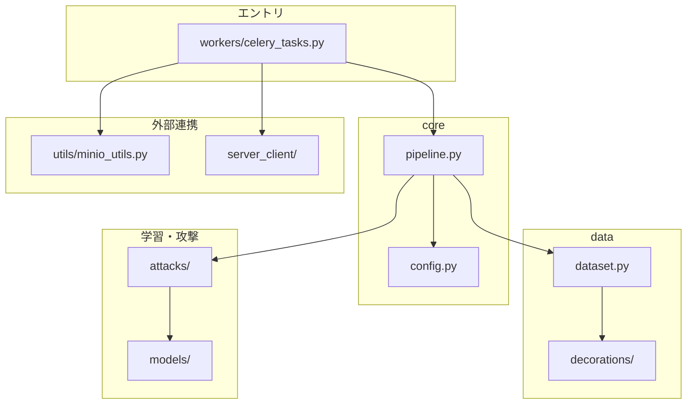


| パス               | 役割                                 |
| ---------------- | ---------------------------------- |
| `core/`          | 環境変数・定数・実験パイプライン                   |
| `data/`          | CIFAR-100 分割・装飾・DataLoader         |
| `models/`        | TargetCNN / AttackNet              |
| `attacks/`       | Offline / Online LiRA / Shokri / LF_MIA / LF_Mult_MIA / LF_Mult_Diff_MIA。`analysis/`（解析・可視化）、`membership_scorers/`（LF_MIA 系の攻撃モデル） |
| `workers/`       | Celery タスク                         |
| `utils/`         | MinIO アップロード・ダウンロード                |
| `server_client/` | 自動生成 API クライアント                    |


---

## ジョブ処理フロー

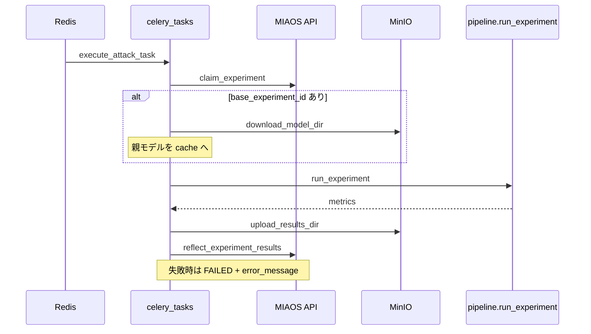

成功時、`metrics` はトップレベル指標と `other_metrics` に分割して API へ送る（`celery_tasks.build_other_metrics` 参照）。

---

## 実験パイプライン（`pipeline.py`）

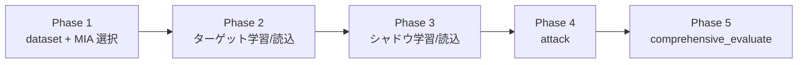

Phase 5 は全手法で ROC / AUC / TPR@FPR を計算する。LF_MIA 系は加えて `attack_score` / `attack_fraction`（各 24 要素リスト）等を metrics に集約する。


| Phase | 内容                                                                                                       |
| ----- | -------------------------------------------------------------------------------------------------------- |
| 1     | `dataset(work_dir, request)` 構築（分割は request のみ参照）、MIA 手法選択（下表）                                      |
| 2     | `train_target_model(model_factory)` で学習、または `load_target_model=True` 時に `assigned_model_path` から読込（LF_MIA 系は 24 体） |
| 3     | シャドウ複数学習、または `load_shadow_model=True` 時に `assigned_model_path` から先頭 `num_shadow_models` 体を読込 |
| 4     | `attack(shadow_models, target_model)` → スコア・参照値（`target_model` の型は手法により単一 / リスト）                    |
| 5     | `comprehensive_evaluate` → metrics 辞書（手法により内容が異なる）                                                      |

### Phase 2: ターゲットモデル

訓練時は全手法で同じ呼び出しを用い、サブクラスの `train_target_model` に委譲する。

```python
target_model = mia_class.train_target_model(lambda: TargetCNN())
```

読込時のみ LF_MIA 系（`LfMia` / `LfMultMia` / `LfMultDiffMia`）と他手法で分岐する。LF_MIA 系の `target_model.pth` は `list[state_dict]`（24 体）、他手法は単一 `state_dict`。

`assigned_model_path` を指定したのに `load_target_model` / `load_shadow_model` / `load_attack_model` がすべて `False` の場合、およびパスが存在しない場合は `ValueError` で即時終了する。`load_attack_model` はこの検証にのみ使われ、攻撃モデルの読込は実装されていない（常に再学習）。


### MIA 手法選択（Phase 1）

| `method`（`MiaMethod`） | クラス               | 前提                                                                 |
| --------------------- | ----------------- | ------------------------------------------------------------------ |
| `OfflineLira`         | `MIA_OfflineLiRA` | —                                                                  |
| `OnlineLira`          | `MIA_OnlineLiRA`  | —                                                                  |
| `Shokri`              | `MIA_Shokri`      | —                                                                  |
| `LfMia`               | `LF_MIA`          | `target_train_decoration`（未指定時は Phase 2 で `ValueError`）/ `attack_decoration`（`watermark` 以外・未指定時は Phase 4 で `ValueError`）が必須。`shadow_decoration` は未指定でもエラーにならないが、IN シャドーが装飾なしになり攻撃が無意味になる |
| `LfMultMia`           | `LF_Mult_MIA`     | `LfMia` と同じ。加えて `attack_decoration` の透かしを target test 画像 K 枚に合成して攻撃。**`hyperparameters.attack_num_images`（K）の指定が必須** |
| `LfMultDiffMia`       | `LF_Mult_Diff_MIA` | `LfMultMia` と同じ。特徴量を「透かしあり − 透かしなし」の logit 差分にする |

`LfMultMia` / `LfMultDiffMia` は `MiaMethod`（OpenAPI 生成ファイル）に手編集で追加している。`make openapi` で再生成すると消えるため、サーバ側スキーマにも同値を追加する必要がある。


`attack()` の戻り値は `(scores, trues)`。`comprehensive_evaluate(scores, trues)` の引数順と一致する。

| 手法            | `attack()` 第2引数 `target_model` | `attack()` 戻り値                         | Phase 5 の主な成果物                                      |
| ------------- | ------------------------------- | -------------------------------------- | --------------------------------------------------- |
| LiRA / Shokri | `nn.Module`（単一）                 | `(np.ndarray, np.ndarray)` スコア配列・真値ラベル | `roc_curve.png`、`global_auc`、TPR@FPR 等               |
| LF_MIA 系（`LfMia` / `LfMultMia` / `LfMultDiffMia`） | `list[nn.Module]`（24 体）          | `(list[float], list[float])` スコア・装飾適用率（各 24 要素）。`attack_score` は membership scorer が K 枚分を集約したスコア（`LfMia` は K=1）。スケールは `membership_score_scale` | `roc_curve.png`（ターゲット単位。fraction>0 を IN、fraction=0 を OUT）、`global_auc`、TPR@FPR 等、`attack_score` / `attack_fraction`。Phase 4 中に `roc_curve_all_scores.png`、`attack_score_distribution/`、`target_attacksign_output/`、`shadow_pair_effect/`、（`neural` のみ）`analyze_attack_model/` を出力 |


ログ: `work_dir/execution.log` + stdout

---

## `data/` — 責務分担

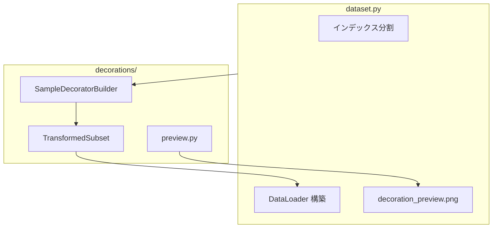


| モジュール          | 責務                                     |
| -------------- | -------------------------------------- |
| `dataset.py`   | CIFAR 分割、`get_*_dataloaders`、装飾プレビュー保存、`get_attack_watermark_dataloader` / `get_attack_composite_dataloaders`（薄いファサード） |
| `decorations/` | 装飾設定パース・適用・透かし I/O・黒背景透かし画像生成・K 枚合成テンソル生成 |


`dataset` は透かしの MinIO 取得や PIL 合成を**持たない**。黒背景 1 枚は `watermark/watermark_on_black.py`、K 枚合成は `watermark/composite.py` に委譲する。インデックス選定と DataLoader の組み立ては `dataset` が担当する。

---

## データ分割

`dataset.json` は使わない。毎回 `CreateExperimentRequest` の入力から分割を再計算する。

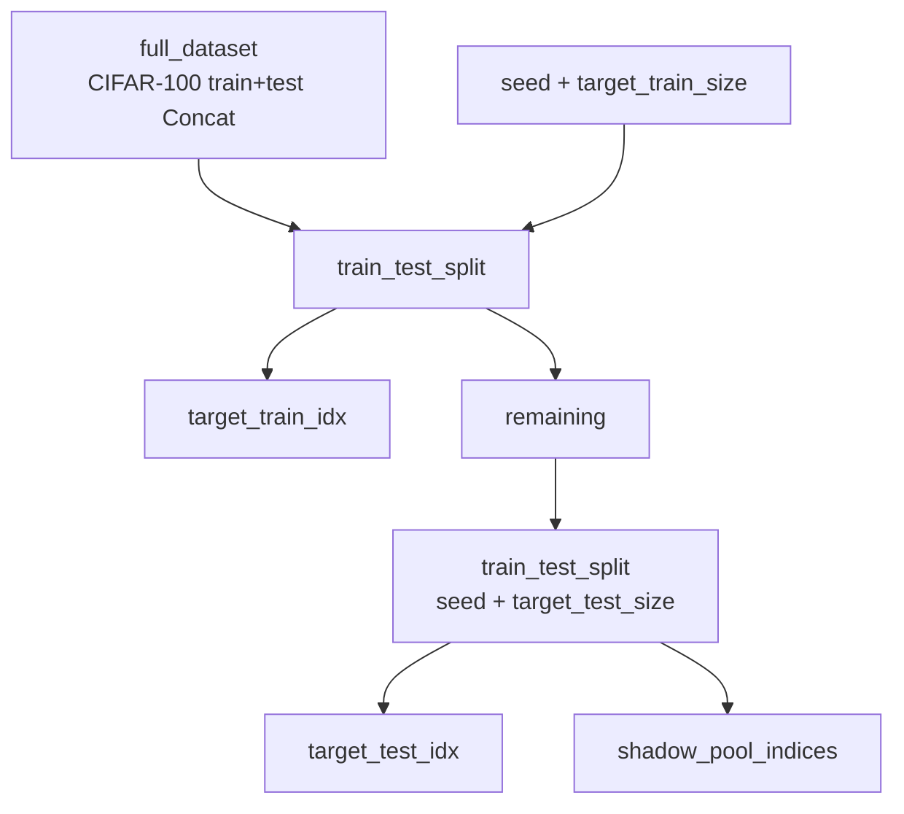


シャドウ分割は `shadow_pool_indices` から `seed + i` で毎シャドウ再計算（`dataset.json` に保存しない）。

### `base_experiment_id` の契約

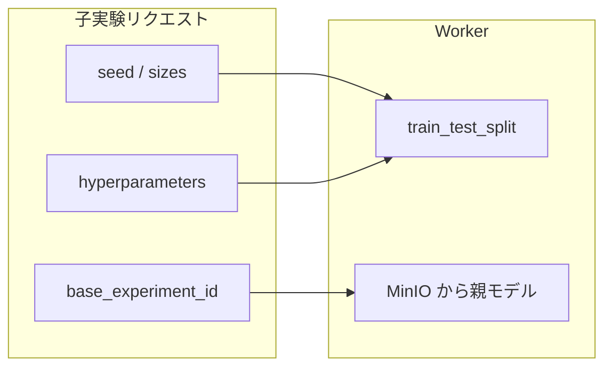


親モデル流用時、呼び出し側が親と**同じ `seed` / `target_train_size` / `target_test_size`** を指定することで同一分割を再現する。Worker は親パラメータを API から取得しない。

### DataLoader 対応

| メソッド | 用途 | transform | shuffle |
| -------- | ---- | --------- | ------- |
| `get_target_dataloaders(decoration_spec=None)` | ターゲット学習。`decoration_spec` 省略時は `target_train_decoration` | `transform_train` / `transform_test` | train のみ `True` |
| `get_shadow_dataloader(seed, is_decoration)` | シャドー学習（Offline LiRA / Shokri / LF_MIA 系）。`is_decoration` で `shadow_decoration` 適用可否（LF_MIA の IN/OUT 分岐） | 同上 | train のみ `True` |
| `get_online_lira_shadow_dataloader(seed, query_indices, query_keep)` | Online LiRA シャドー学習。shadow pool 分割に keep=True のクエリサンプルを加える（装飾なし） | 同上 | train のみ `True` |
| `get_eval_target_dataloaders` / `get_eval_shadow_dataloader` | 攻撃評価（Shokri / LiRA）。`eval_decoration` を適用 | `transform_test` | `False` |
| `get_attack_watermark_dataloader` | LF_MIA 攻撃用透かし 1 枚 | `transform_test` | `False`（`batch_size=1`） |
| `get_attack_composite_dataloaders(num_images)` | LF_Mult_MIA 系。target test から K 枚を選び、透かし合成済み / 素の画像の 2 loader を返す | `transform_test` | `False`（`batch_size=K`） |

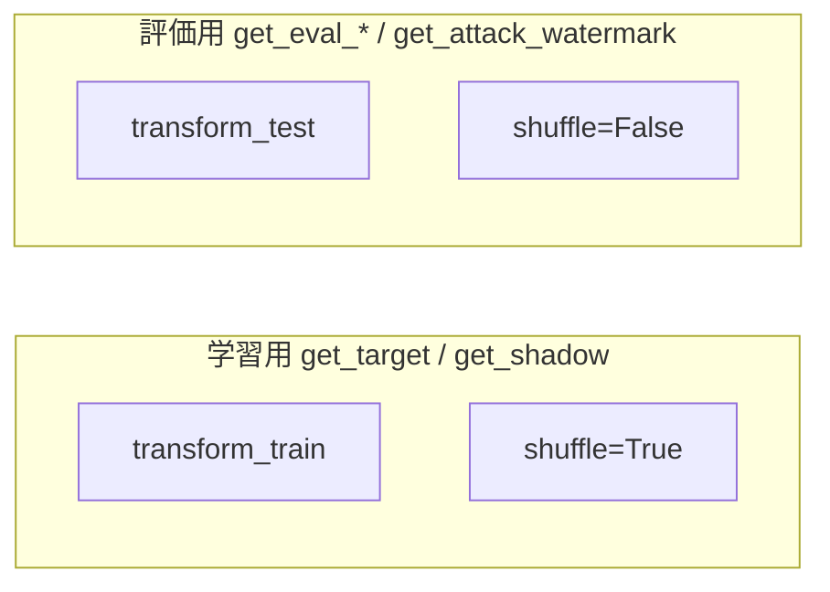


---

## `data/decorations/` — サンプル装飾

設定の唯一の経路: `hyperparameters.eval_decoration` / `target_train_decoration` / `shadow_decoration` / `attack_decoration`  
1 サンプルに同時適用する装飾は 1 種類。Normalize 前の PIL 段階で適用。  
`hyperparameters` の全キー（装飾オブジェクトのフィールド・制約を含む）は [`HYPERPARAMETERS.md`](HYPERPARAMETERS.md) を参照。

### モジュール構成

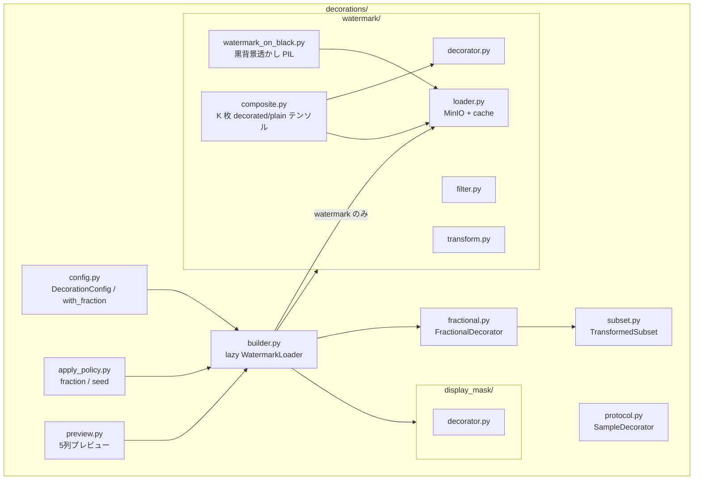


### `WatermarkLoader` の lazy 初期化

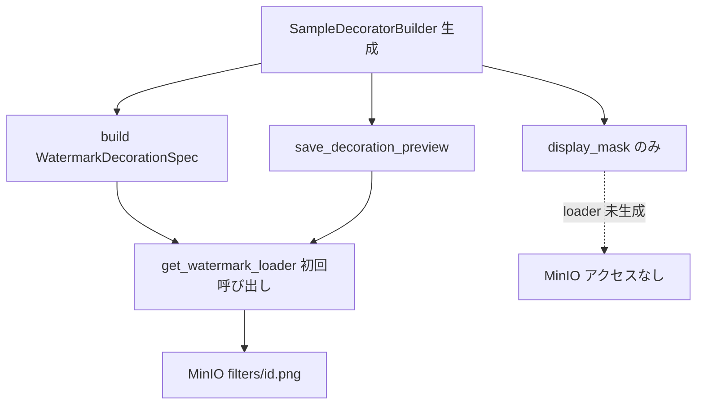


透かし装飾が不要な実験では `WatermarkLoader` は作られない。

### 装飾パイプライン

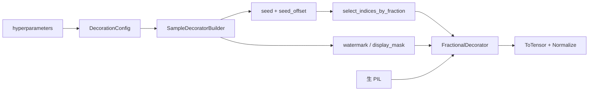


### 設定例

```json
{
  "eval_decoration": {"type": "watermark", "filter_id": "circle", "fraction": 1.0},
  "target_train_decoration": {
    "type": "display_mask",
    "width": 16, "height": 16, "position": [0, 0],
    "fraction": 0.5, "seed_offset": 0
  },
  "shadow_decoration": {"type": "watermark", "filter_id": "circle", "fraction": 1.0},
  "attack_decoration": {"type": "watermark", "filter_id": "circle", "fraction": 1.0}
}
```


| キー                        | 適用先                                                          |
| ------------------------- | ------------------------------------------------------------ |
| `eval_decoration`         | `get_eval_target_dataloaders` / `get_eval_shadow_dataloader` / `get_eval_decorated_sample`（LiRA / Shokri。LF_MIA 系では不使用） |
| `target_train_decoration` | `get_target_dataloaders` の train（全手法）。LF_MIA 系では装飾種別（`filter_id` 等）のベース spec。`apply.fraction` は固定リストで上書き（下記 LF_MIA） |
| `shadow_decoration`       | LF_MIA: `get_shadow_dataloader(..., is_decoration=True)` の IN シャドー学習データ |
| `attack_decoration`       | `get_attack_watermark_dataloader`（LF_MIA の攻撃用透かし 1 枚。`watermark` のみ）/ `get_attack_composite_dataloaders`（LF_Mult_MIA 系の合成透かし。`watermark` のみ） |

### `get_attack_watermark_dataloader`（`dataset.py`）

`attack_decoration` の `filter_id` で黒背景透かし PIL を 1 枚生成し、`transform_test` 適用後 `(1, 3, H, W)` の `DataLoader`（`batch_size=1`）として返す。`MIA_Attack.get_predictions` と組み合わせて LF_MIA の特徴抽出・ターゲット推論に使う。正解ラベルは持たないためダミー `0` を付与。

### `get_attack_composite_dataloaders(num_images)`（`dataset.py`）

`target_test_idx` から `RandomState(seed)` で K 枚を非復元抽出し、取得した PIL 画像リストを `watermark/composite.py` の `build_decorated_plain_tensors` に渡す。透かし合成（`WatermarkDecorator` 経由の alpha ブレンド）と `transform_test` 適用は `composite` 側で行い、`dataset` は返却テンソルを `DataLoader`（`batch_size=K`, `shuffle=False`）に載せるだけである。

- decorated: 透かし合成済み `(K, 3, H, W)`
- plain: 素の画像 `(K, 3, H, W)`（順序は decorated と同一）

target test はターゲット・シャドー双方の訓練データと重複しないため、合成のベース画像として用いてもメンバーシップ情報を持ち込まない。`num_images` が target test サイズを超える場合はエラー。`attack_decoration` は `watermark` 型のみ。

### LF_MIA における `shadow_decoration`

`LF_MIA.train_shadow_models` はシャドーを IN / OUT の 2 群に分けて学習する。

| 群       | 件数                      | データ取得                                              |
| ------- | ----------------------- | -------------------------------------------------- |
| IN シャドー | `num_shadow_models / 2` | `get_shadow_dataloader(seed=i, is_decoration=True)`  |
| OUT シャドー | 同上                      | `get_shadow_dataloader(seed=i, is_decoration=False)` |

`is_decoration=True` のときのみ `shadow_decoration` が train / test 双方に適用される。IN シャドー i と OUT シャドー i は同じ `seed=i` でデータ分割を共有し、違いは装飾の有無と初期化・SGD の乱数のみ（ペア設計）。

LiRA / Shokri のシャドー学習データには装飾を適用しない（`get_shadow_dataloader(seed)` / `get_online_lira_shadow_dataloader`）。


| `type`         | パラメータ                                                                         |
| -------------- | ----------------------------------------------------------------------------- |
| `watermark`    | `filter_id`, `fraction`（省略時 1.0）, `seed_offset`（省略時 0）                        |
| `display_mask` | `width`（省略時 16）, `height`（省略時 16）, `position`（`[x,y]` / `{x,y}`、または `x`/`y`。省略時 `(0, 0)`）, `fraction`, `seed_offset` |


**適用ポリシー（全装飾共通）**

- `fraction` / `seed_offset` は装飾オブジェクトの直下に書く（内部では `DecorationSpec.apply` に格納）
- `with_fraction(spec, fraction)` — `DecorationSpec` の `apply.fraction` だけを上書き（LF_MIA のターゲット学習スイープで使用）
- 選定シード: `experiment.seed + seed_offset`
- 同じ `fraction` + `seed_offset` + 同じ pool → type が違っても同一サンプルに適用
- 透かしフィルタ: `WatermarkLoader` が MinIO `filters/{filter_id}.png` を `./cache/filters/` に取得
- デバッグ: `work_dir/decoration_preview.png`（左から plain / target / eval / shadow / attack の5列。未設定列は plain と同一）

`CreateExperimentRequest.watermark`（トップレベル）は**無視**。装飾は `hyperparameters` のみ。

---

## `attacks/` — MIA 手法

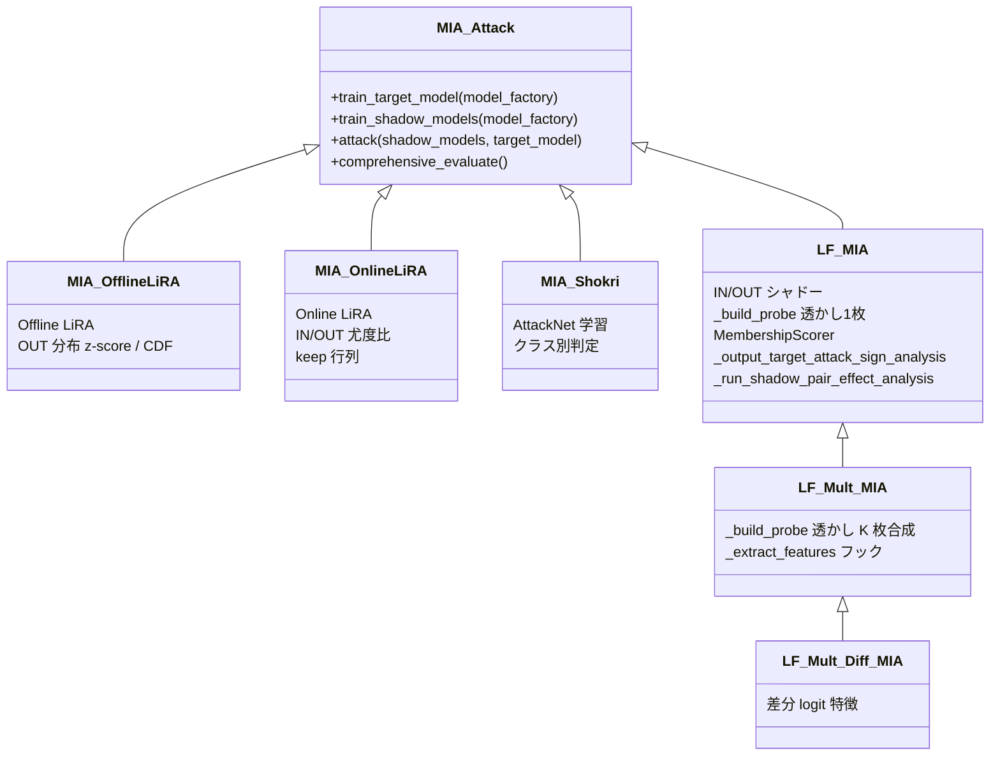


| クラス               | 概要                                             |
| ----------------- | ---------------------------------------------- |
| `MIA_Attack`      | 学習・予測・ROC 共通基底                                 |
| `MIA_OfflineLiRA` | シャドウ OUT 分布から z-score → CDF スコア（論文 Equation 4） |
| `MIA_OnlineLiRA`  | シャドウ IN/OUT 分布から対数尤度比スコア（論文 Algorithm 1）       |
| `MIA_Shokri`      | ソフトマックス特徴 → `AttackNet`（クラス別。エポック数は `cfg.ATTACK_MODEL_EPOCHS` 固定）                  |
| `LF_MIA`          | 装飾あり/なしシャドー + 攻撃用透かし（黒背景 1 枚, K=1）→ membership scorer。ターゲットは装飾適用率 24 体（`LF_MIA_TARGET_FRACTIONS`）で学習・攻撃。攻撃末尾でシャドー IN/OUT ペア効果量解析（`shadow_pair_effect/`）を出力     |
| `LF_Mult_MIA`     | `LF_MIA` 派生。プローブを「透かしを target test 画像 K 枚に合成したもの」に差し替える（`_build_probe` のオーバーライド）。学習・集約は membership scorer が担う |
| `LF_Mult_Diff_MIA` | `LF_Mult_MIA` 派生。特徴量を `logit(透かしあり) − logit(透かしなし)` の差分にして画像固有成分を打ち消す |


### LF_MIA（`lf_mia.py`）

#### ターゲットモデル（Phase 2）

LF_MIA は `target_train_decoration.apply.fraction` を無視し、固定の装飾適用率リストでターゲットモデルを 24 体学習する。装飾種別（`filter_id`, `seed_offset` 等）は `target_train_decoration` をベースに、`config.with_fraction` で fraction だけ上書きする。

```python
LF_MIA_TARGET_FRACTIONS = [
    1.0, 0.9, 0.8, 0.7, 0.6, 0.5, 0.4, 0.3, 0.2, 0.1, 0.01, 0.001,  # IN（12 体）
    0.0, 0.0, 0.0, 0.0, 0.0, 0.0, 0.0, 0.0, 0.0, 0.0, 0.0, 0.0,     # OUT（12 体）
]
```

`LF_MIA.train_target_model(model_factory)` が基底 `MIA_Attack.train_target_model` をオーバーライドし、各 fraction で `get_target_dataloaders(decoration_spec=...)` を呼んで学習する。戻り値は `list[nn.Module]`（24 体）。`target_model.pth` には `list[state_dict]` を保存する。

- 全ターゲットは同じ学習データ（`target_train_idx`）を使う。違いは装飾適用率と初期化シードのみ。
- 初期化シード: fraction>0 の 12 体はすべて `seed`（同一初期重み）。fraction=0 は n 体目（0 始まり）が `seed + n`（1 体目は `seed`）。
- 評価ラベル: fraction>0 を IN（1）、fraction=0 を OUT（0）とする。

#### 攻撃（Phase 4）

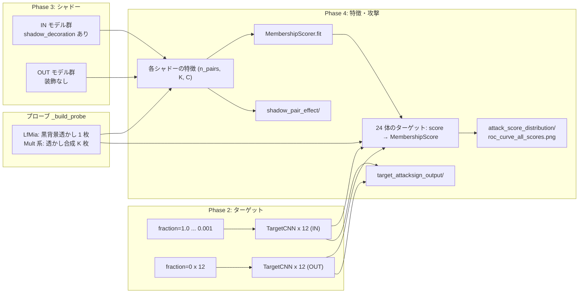

1. `_build_probe()` がモデル 1 体から特徴 `(K, NUM_CLASSES)` を返す callable を作る。`LF_MIA` は `get_attack_watermark_dataloader`（黒背景透かし 1 枚, K=1）の softmax に `logit_scaling` を適用する。Mult 系は下記。
2. `_collect_shadow_features` で IN / OUT シャドーの特徴 `(n_pairs, K, NUM_CLASSES)` を得る（シャドーは IN, OUT の順で半々。`n_pairs = num_shadow_models / 2`）。
3. `hyperparameters.membership_scorer` で選んだ membership scorer（下記）を **1 回** `fit` する。`neural` の場合のみ `analyze_attack_model/` と `attack_models.pth` / `attack_model_init.pth` を出力する。
4. 24 体のターゲットそれぞれで同じプローブの特徴を取り、`scorer.score(feats)` が `MembershipScore(value, per_image)` を返す。
   - `attack_score`: `value`（スコアラーが K 枚分を集約したスコア。長さ 24 のリスト）
   - `attack_scores_vars`: `per_image` の標本分散（K=1 のときは 0.0）
   - `attack_fraction`: `LF_MIA_TARGET_FRACTIONS` の対応値（装飾適用率。評価時に fraction>0 を IN とみなす）
5. `per_image` を `attack_score_distribution/` に出力し（下記）、全ターゲットの `per_image` を展開した ROC（各値にそのターゲットのラベルを付与）を `roc_curve_all_scores.png` と `all_scores_*` metrics に出力する。
6. `_output_target_attack_sign_analysis` で 24 体のターゲットそれぞれに `get_attack_watermark_dataloader` の透かし 1 枚を再入力し、softmax 確率を `target_attacksign_output/` に保存する（下記）。LF_MIA 系全手法で同一。
7. `attack()` 最末尾で `_run_shadow_pair_effect_analysis` を呼び、シャドー IN/OUT ペアのクラス別装飾効果量を `shadow_pair_effect/` に出力する（下記）。攻撃スコアには影響しない。

Phase 5 の `comprehensive_evaluate` は `attack_score` と「fraction>0 を IN（1）、fraction=0 を OUT（0）」としたラベルで ROC を計算し、`roc_curve.png` と `global_auc` / `tpr_at_*_fpr` / `threshold_at_*_fpr` を出力する。閾値の単位は `membership_score_scale` に従う。

ハイパーパラメータは [`HYPERPARAMETERS.md`](HYPERPARAMETERS.md) を参照。

保存物:

| ファイル / ディレクトリ | 内容 |
| -------- | ---- |
| `target_model.pth` | LF_MIA 系: `list[state_dict]`（24 体）。他手法: 単一 `state_dict` |
| `shadow_models.pth` | 全シャドーの `list[state_dict]`（IN, OUT の順） |
| `attack_models.pth` | （`neural` のみ）攻撃モデル 1 体の `state_dict` |
| `attack_model_init.pth` | （`neural` のみ）攻撃モデル訓練前の初期重み（`analyze_attack_model` の差分ベースライン） |
| `analyze_attack_model/` | （`neural` のみ）攻撃モデル解析結果（重みヒートマップ・クラス重要度・入力感度等の PNG + `summary.json`） |
| `roc_curve.png` | ターゲット単位（`attack_score`）の ROC |
| `roc_curve_all_scores.png` | 画像ごとのスコア（`per_image`）全体の ROC |
| `attack_score_distribution/` | `scores.json`（全ターゲット）。K>=2 のときのみ `histogram_overlay.png` / `histogram_facet.png` / `violin.png` |
| `target_attacksign_output/` | ターゲットモデルへの攻撃透かし入力時のクラス別確率棒グラフ + `summary.json` |
| `shadow_pair_effect/` | シャドー IN/OUT ペア効果量解析（PNG 4 枚 + `summary.json`。下記） |

metrics には ROC 指標・`attack_score` / `attack_fraction` に加えて、`target_train_accs` / `target_test_accs` / `target_acc_gaps`、`shadow_train_accs` / `shadow_test_accs` / `shadow_acc_gaps`、`membership_scorer` / `membership_score_scale`、スコアラーの diagnostics、`attack_scores_vars`、`all_scores_auc` / `all_scores_tpr_at_*_fpr` / `all_scores_threshold_at_*_fpr`、シャドー IN/OUT ペア効果量解析由来の `shadow_pair_global_permutation_pvalue` / `shadow_pair_num_significant_fdr` を格納する。

スコアラーの diagnostics:

| `membership_scorer` | キー |
| ------------------- | ---- |
| `neural` | `w1_relative_change`, `attack_model_train_acc` / `attack_model_train_loss` / `attack_model_train_in_acc` / `attack_model_train_out_acc` |
| `diagonal_lda` | `diagonal_lda_reg_lambda`, `diagonal_lda_w_norm`, `diagonal_lda_b` |
| `flat_diagonal_lda` | `flat_diagonal_lda_reg_lambda`, `flat_diagonal_lda_variance`, `flat_diagonal_lda_w_norm`, `flat_diagonal_lda_b`, `flat_diagonal_lda_w_norm_per_image`（K 要素リスト） |
| `gaussian_lr` | `gaussian_lr_variance`, `gaussian_lr_var_floor`, `gaussian_lr_floored_ratio_in` / `gaussian_lr_floored_ratio_out` |

#### 攻撃スコア分布（`analysis/attack_score_distribution.py`）

出力先は `MODEL_SAVE_DIR/attack_score_distribution/`（`config.ATTACK_SCORE_DISTRIBUTION_DIR`）。

- `scores.json`: `scale`（`probability` / `log_odds`）と、ターゲットごとの `label` / `fraction` / `score`（集約スコア）/ `mean` / `var` / `scores`（`per_image`）
- 図（全ターゲットで K>=2 のときのみ）: 重ね描きヒストグラム、Facet ヒストグラム、バイオリンプロット。破線・黒バーは `per_image` の平均。横軸は `probability` なら `[0, 1]`、`log_odds` なら全値の範囲に余白を付けたもの
- 配色: IN（fraction>0）は fraction の降順に濃い赤から淡い赤、OUT（fraction=0）は青

#### 攻撃モデル解析（`analysis/attack_model_analysis.py`）

`membership_scorer=neural` のとき、`NeuralMembershipScorer.fit` 内で `AttackNet` 訓練後に `analyze_attack_model` を呼び出す。出力先は `MODEL_SAVE_DIR/analyze_attack_model/`（`config.ATTACK_MODEL_ANALYSIS_DIR`）。

- 学習済み重みのスナップショット（`weight_heatmap.png`, `class_importance.png` 等）
- 初期重みとの差分（`delta_*.png`）
- 学習データ `attack_x` / `attack_y` 上の到達度・入力勾配（`input_gradient_*.png` 等）
- `summary.json`（重みサマリ・fit 指標・入力感度サマリ）

#### ターゲット攻撃透かし出力の可視化（`analysis/target_attack_sign_output.py`）

`LF_MIA._output_target_attack_sign_analysis` が Phase 4（攻撃スコア計算・スコア分布出力の後）で呼ばれる。LF_MIA 系全手法で同一実装を継承する。出力先は `MODEL_SAVE_DIR/target_attacksign_output/`（`config.TARGET_ATTACKSIGN_OUTPUT_DIR`）。

- 入力: `get_attack_watermark_dataloader` の透かし 1 枚（攻撃特徴抽出とは別経路。Mult 系でも composite loader は使わない）
- 各ターゲットモデルで `MIA_Attack.get_predictions` → softmax 確率 `(NUM_CLASSES,)`
- PNG: `class_probabilities_fraction_{fraction}.png`（fraction の `.` を `_` に置換。例: `1.0` → `1_0`）。ファイル名は fraction のみで決まるため、fraction=0 の 12 体は同じ `class_probabilities_fraction_0_0.png` に上書きされ、最後の 1 体分だけが残る（PNG は計 13 枚）
- `summary.json`: 24 体分の `fraction` / `probs`（100 要素）/ `argmax_class` / `argmax_value` / `top_classes`（上位 10 クラス）/ `plot_path`
- 描画スタイルは `attack_model_analysis.plot_class_importance` を再利用（`figsize=(16,5)`, `dpi=300`）

#### シャドー IN/OUT ペア効果量解析（`analysis/shadow_pair_effect_analysis.py`）

`LF_MIA._run_shadow_pair_effect_analysis` が Phase 4 末尾（`_output_target_attack_sign_analysis` の後）で呼ばれる。LF_MIA 系全手法で同一フックを使用する。出力先は `MODEL_SAVE_DIR/shadow_pair_effect/`（`config.SHADOW_PAIR_EFFECT_DIR`）。membership scorer には依存しないモデル非依存の診断。

**ペア設計**: `train_shadow_models` は `seed=i` で IN シャドー i と OUT シャドー i の訓練サブセットを揃える。各ペアに同じプローブを入力し、クラス c ごとの差分 `mean(IN[:,c] - OUT[:,c])` を装飾効果の推定量とする。

**特徴**: 攻撃本体で `_collect_shadow_features` が抽出した `(n_pairs, K, NUM_CLASSES)` を **K 方向に平均**して `(n_pairs, NUM_CLASSES)` とする（再推論はしない）。

| 手法 | プローブ | 1 シャドーあたりの特徴 |
| ---- | -------- | ---------------------- |
| `LF_MIA` | `get_attack_watermark_dataloader`（黒背景透かし 1 枚, K=1） | `logit_scaling(softmax)` → `(NUM_CLASSES,)` |
| `LF_Mult_MIA` | `get_attack_composite_dataloaders(K)` の透かし合成 K 枚 | `_extract_features` → `(K, NUM_CLASSES)` の K 枚平均 → `(NUM_CLASSES,)` |
| `LF_Mult_Diff_MIA` | 同上 | 差分特徴 `logit(透かしあり) − logit(透かしなし)` の K 枚平均 |

Wilcoxon 等の統計単位は `n_pairs = num_shadow_models / 2` とする。

**統計量**（クラス c ごと）:

| 量 | 定義 |
| -- | ---- |
| `mean_diff[c]` | `mean(IN[:,c] - OUT[:,c])` |
| `cohens_d[c]` | ペア差分の Cohen's d（`std=0` なら `null`） |
| `wilcoxon_p[c]` | 両側 Wilcoxon 符号順位検定（`n_pairs < 6` または全ゼロなら `null`） |
| Bonferroni 有意 | `wilcoxon_p * n_classes < alpha` |
| BH-FDR 有意 | Benjamini–Hochberg（`alpha=0.05`） |
| `global_permutation_p` | `T_obs = max_c \|mean_diff[c]\|` に対する符号反転置換検定（`config.SHADOW_PAIR_N_PERMUTATIONS` 回） |

**出力ファイル**:

| ファイル | 内容 |
| -------- | ---- |
| `summary.json` | 下記スキーマ |
| `mean_diff_bar.png` | クラス別 `mean_diff`（正=IN 方向、負=OUT 方向） |
| `cohens_d_bar.png` | クラス別 Cohen's d |
| `wilcoxon_neglog10_p_bar.png` | `-log10(wilcoxon_p)`。Bonferroni 実線・BH-FDR 破線の有意閾値線付き |
| `volcano.png` | x=`mean_diff`、y=`-log10(wilcoxon_p)`。Bonferroni/FDR 水平線付き |

`wilcoxon_p` が `null` のクラスは Wilcoxon 系グラフでは非表示。

**`summary.json` スキーマ**:

```json
{
  "n_pairs": 50,
  "alpha": 0.05,
  "n_permutations": 9999,
  "global_permutation_p": 0.001,
  "top_class_by_abs_cohens_d": 42,
  "top_class_cohens_d": 1.23,
  "significant_class_ids_bonferroni": [42, 7],
  "significant_class_ids_fdr": [42, 7, 15],
  "classes": {
    "0": {"mean_diff": 0.01, "cohens_d": 0.05, "wilcoxon_p": 0.82},
    ...
  }
}
```

**metrics**（`other_metrics` へ自動収集。2 キーのみ）:

| キー | 意味 |
| ---- | ---- |
| `shadow_pair_global_permutation_pvalue` | グローバル置換検定 p 値 |
| `shadow_pair_num_significant_fdr` | BH-FDR 有意クラス数（主指標） |

クラス別の詳細数値・`n_pairs`・`top_class_cohens_d`・Bonferroni 有意クラス一覧は `summary.json` のみ（metrics には載せない）。

### LF_Mult_MIA / LF_Mult_Diff_MIA（`lf_mult_mia.py` / `lf_mult_diff_mia.py`）

`LF_MIA` を継承し、Phase 2 / 3 と `attack()` 本体はそのまま再利用する。`_build_probe`（プローブ = 入力画像の作り方）と `_extra_attack_metrics` のみ置き換える。

1. `_build_probe` で `get_attack_composite_dataloaders(K)` から透かし合成済み / 素の画像 K 枚の loader を取得する（K は `hyperparameters.attack_num_images`。**必須**）。
2. `_extract_features(model, decorated_loader, plain_loader)` でモデル 1 体から `(K, NUM_CLASSES)` の特徴を得る。
   - `LF_Mult_MIA`: `logit_scaling(softmax(透かしあり))`（`plain_loader` は未使用）
   - `LF_Mult_Diff_MIA`: `logit_scaling(softmax(透かしあり)) − logit_scaling(softmax(透かしなし))`
3. 以降（membership scorer の学習・ターゲット推論・各種解析）は `LF_MIA` と同一。`neural` の場合は IN / OUT シャドーの特徴を `(n_pairs × K × 2, NUM_CLASSES)` に展開し、ラベルは IN=1 / OUT=0 をモデルごとに K 回繰り返して `AttackNet`（`input_dim=NUM_CLASSES`）を 1 回学習する。
4. `_extra_attack_metrics` で `attack_num_images` を metrics に追加する。

同じ K 枚が IN / OUT 両群・全ターゲットに現れるため、画像内容はラベルに対して無情報であり、攻撃は透かしが出力に与える差分を使わざるを得ない。ただし K 本の出力は同一モデル由来で相関するため、有効標本数は K 倍にはならない（シャドー数が実質的なボトルネック）。

`attack_num_images` の仕様は [`HYPERPARAMETERS.md`](HYPERPARAMETERS.md) を参照。

### Membership scorer（`attacks/membership_scorers/`）

LF_MIA 系の攻撃モデル。`hyperparameters.membership_scorer` で選択し、`build_membership_scorer(MembershipScorerConfig)` で生成する。`fit(in_feats, out_feats)` は `(n_pairs, K, C)`、`score(feats)` は `(K, C)` を受け取り `MembershipScore(value: float, per_image: (K,))` を返す。`score_scale`（`ScoreScale.PROBABILITY` / `LOG_ODDS`）は metrics の `membership_score_scale` として出力され、`attack_score` / `threshold_at_*` の単位を表す。

| モジュール | 内容 |
| ---------- | ---- |
| `base.py` | `MembershipScorer`（Protocol）, `MembershipScore`, `ScoreScale` |
| `neural.py` | `NeuralMembershipScorer` |
| `diagonal_lda.py` | `DiagonalLdaMembershipScorer`, 共通推定関数 `fit_diagonal_linear`, `DiagonalVariance` |
| `flat_diagonal_lda.py` | `FlatDiagonalLdaMembershipScorer` |
| `gaussian_lr.py` | `GaussianLrMembershipScorer`, `GaussianVariance` |
| `__init__.py` | `MembershipScorerConfig`（hyperparameters のパース・検証）, `build_membership_scorer` |

| `membership_scorer` | 手法 | `per_image` | `value` | `score_scale` |
| ------------------- | ---- | ----------- | ------- | ------------- |
| `neural`（既定） | `AttackNet` で画像ごとに IN/OUT 分類 | 画像ごとの IN 確率 | 平均 | `probability` |
| `diagonal_lda` | K 平均した特徴に対する対角 LDA（分母はペア差分の分散） | 画像ごとの logit | 平均 | `log_odds` |
| `flat_diagonal_lda` | `(K·C)` に平坦化した対角 LDA（(k, c) ごとに独立な重み） | 画像ごとの寄与 `w_k·x_k + b/K` | 和 | `log_odds` |
| `gaussian_lr` | (k, c) ごとに IN/OUT の正規分布を推定する尤度比検定（LiRA の拡張） | 画像ごとの対数尤度比の和 | 和 | `log_odds` |

`flat_diagonal_lda` / `gaussian_lr` は次元間の相関を無視するため、`|value|` は K·C に比例して大きくなる。順位付け（ROC）にのみ用いる。

| キー | 対象 | 既定値 | 用途 |
| ---- | ---- | ------ | ---- |
| `diagonal_lda_reg_lambda` | `diagonal_lda` / `flat_diagonal_lda` | `1e-3` | 分散に加える正則化項 |
| `flat_diagonal_lda_variance` | `flat_diagonal_lda` | `within_class` | 重みの分母。`within_class`（IN/OUT の分散のプール）/ `pair_diff`（ペア差分の分散） |
| `gaussian_lr_variance` | `gaussian_lr` | `per_class` | `per_class`（IN/OUT 別々の分散）/ `pooled`（共通の分散） |
| `gaussian_lr_var_floor` | `gaussian_lr` | `1e-3` | 分散の下限（logit 飽和で分散 0 になる次元への対策） |

各クラスのシャドーが 1 本（`n_pairs=1`）のときは分散が定義できないため、分散を正則化項 / 下限のみとして動作する。


### LiRA 共通モジュール（`mia_lira_common.py`）

- `logit_scaling` — 確率テンソルの logit 変換（LiRA は正解クラス抽出後に使用。LF_MIA 系は全クラス softmax に適用）
- `extract_correct_class_logits` — 1 モデルから正解クラス確率の logit をクエリ順（train → test）に抽出
- `extract_shadow_logits_matrix` — 全シャドウモデルからロジット行列 `(num_shadows, num_samples)` を抽出
- `split_online_lira_sample_logits` — Online LiRA: 1 サンプル分のシャドーロジットを keep 行列で IN / OUT に分割
- `plot_sample_shadow_dist_grid` — サンプルごとのシャドー分布とターゲット値のグリッド図（`sample_shadow_dist_grid.png`。右上に `eval_decoration` 適用後のサンプル画像を表示）
- `plot_score_distributions` — 攻撃スコア分布の可視化

手法別スコア計算:

- `MIA_OfflineLiRA.attack` 内 — OUT 分布 + CDF（Equation 4）
- `MIA_OnlineLiRA._compute_online_lira_scores` — IN/OUT 尤度比（Algorithm 1）。IN / OUT どちらかのシャドーが 0 本のサンプルがあれば `ValueError`（シャドー 2 本未満も `ValueError`）

### Offline vs Online LiRA


| 項目     | Offline (`MIA_OfflineLiRA`)    | Online (`MIA_OnlineLiRA`)                    |
| ------ | ------------------------------ | -------------------------------------------- |
| シャドウ学習 | `shadow_pool` のみ（攻撃対象は常に OUT）  | `shadow_pool` + クエリサンプル（IN/OUT を keep 行列で制御） |
| 分布推定   | OUT のみ (`μ_out`, `σ_out`)      | IN / OUT 両方                                  |
| スコア    | `Φ((conf - μ_out) / σ_out)`    | `logpdf(conf|IN) - logpdf(conf|OUT)`         |
| 追加成果物  | `sample_shadow_dist_grid.png`, `score_distribution_lira.png`（z スコア）, `score_distribution_lira_cdf.png` | `sample_shadow_dist_grid.png`, `score_distribution_lira.png`（尤度比） |


Online LiRA の keep 行列は `dataset.build_online_lira_keep_matrix(num_shadows, seed)` で決定的に生成する（各クエリサンプルがちょうど `num_shadows // 2` 体のシャドーで IN）。学習時・攻撃時・`load_shadow_model=True` 時いずれも同一の `seed` / sizes があれば同じ行列が得られる。事後分析は保存済みモデル（`shadow_models.pth` 等）のロードと再計算で行う。

---

## `models/`


| モジュール       | 用途                                      |
| ----------- | --------------------------------------- |
| `TargetCNN` | CIFAR-100（3×32×32, 100 クラス）ターゲット・シャドウ共用 |
| `AttackNet` | Shokri / LF_MIA 系（`membership_scorer=neural`）用 2 クラス MLP（`NUM_CLASSES` → 64 → 2） |


---

## MinIO 連携（`utils/minio_utils.py`）

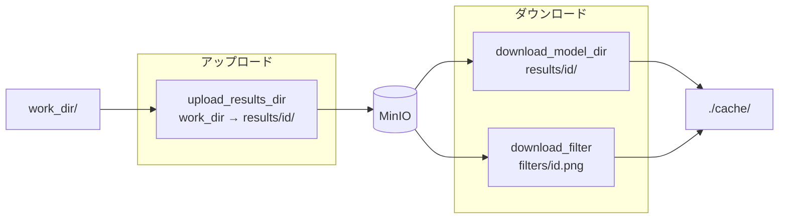


---

## `workers/celery_tasks.py` — 結果の API 送信

`run_experiment` が返す `metrics` 辞書を `UpdateResultsRequest` にマッピングする。

### トップレベル vs `other_metrics`

| 区分            | キー（`metrics` 側）                                                                 | `UpdateResultsRequest` 側 |
| ------------- | ------------------------------------------------------------------------------- | ------------------------ |
| トップレベル        | `global_auc`, `tpr_at_01_fpr`, `tpr_at_1_fpr`, `threshold_at_01_fpr`, `threshold_at_1_fpr`, `total_time_sec` | 同名（`total_time_sec` → `total_time`） |
| `other_metrics` | 上記以外かつ値が `None` でないキー                                                          | `other_metrics` 辞書        |

`build_other_metrics(metrics)` が残りのキーを自動収集する。例:

- LiRA / Shokri: `tpr_at_001_fpr`, `threshold_at_001_fpr`, `shadow_train_accs` 等
- LF_MIA 系: `tpr_at_001_fpr`, `threshold_at_001_fpr`, `attack_score` / `attack_fraction` / `attack_scores_vars`（各 24 要素リスト）, `target_*`, `shadow_*`, `membership_scorer`, `membership_score_scale`, スコアラーの diagnostics（上記 LF_MIA 参照）, `all_scores_*`, `shadow_pair_global_permutation_pvalue`, `shadow_pair_num_significant_fdr` 等
- LF_Mult_MIA / LF_Mult_Diff_MIA: 上記に加え `attack_num_images`

画像ごとのスコア（24 × K）は値が多いため metrics には載せず、`attack_score_distribution/scores.json` にのみ出力する。

`_json_safe_metric_value` で numpy スカラー・配列を JSON 直列化可能な型に変換してから送る。トップレベル取得には `metrics.get(...)` を使用し、一部キーが欠けていても KeyError にならない。

`run_experiment` 中に例外が発生した場合は `status=FAILED`・`error_message=str(e)` で反映する。claim / reflect が 409 を返した場合はスキップ（冪等）、404 はログのみで終了する。

---

## `server_client/`

OpenAPI 生成の httpx クライアント。ワーカーで主に使用:

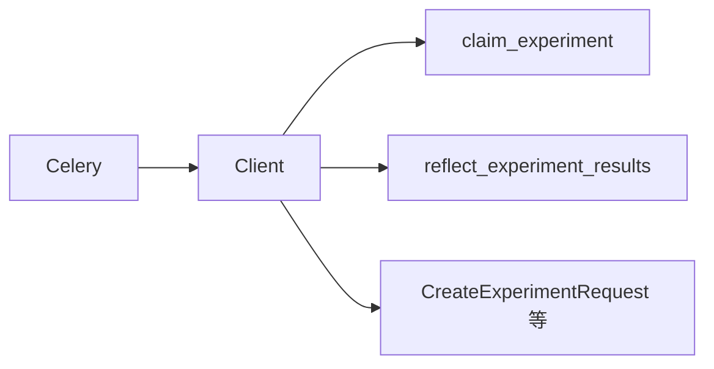


---

## 環境変数


| 変数                                                        | 用途           |
| --------------------------------------------------------- | ------------ |
| `PC_NAME`                                                 | ワーカー識別名      |
| `REDIS_URL`                                               | Celery ブローカー |
| `MINIO_URL` / `MINIO_ACCESS_KEY` / `MINIO_SECRET_KEY` / `MINIO_BUCKET_NAME` | オブジェクトストレージ  |
| `MIAOS_API_URL`                                           | オーケストレータ API |


`core/config.py` 参照。いずれも未設定時は import 時に `KeyError`。`DEVICE` は CUDA 利用可能なら GPU。Celery の `visibility_timeout` は `CELERY_VISIBILITY_TIMEOUT`（16 時間）。

LF_MIA 系で参照する主な定数（抜粋）:

| 定数 | 値 | 用途 |
| ---- | -- | ---- |
| `ATTACK_MODEL_ANALYSIS_DIR` | `analyze_attack_model` | 攻撃モデル解析 PNG / `summary.json` の出力先 |
| `TARGET_ATTACKSIGN_OUTPUT_DIR` | `target_attacksign_output` | ターゲット透かし確率棒グラフ / `summary.json` の出力先 |
| `SHADOW_PAIR_EFFECT_DIR` | `shadow_pair_effect` | シャドー IN/OUT ペア効果量解析 PNG / `summary.json` の出力先 |
| `ATTACK_SCORE_DISTRIBUTION_DIR` | `attack_score_distribution` | ターゲットごとの画像ごとのスコア分布 PNG / `scores.json` の出力先 |
| `ATTACK_MODEL_BATCH_SIZE` | `16` | `neural` スコアラーのバッチサイズ既定値 |
| `ATTACK_MODEL_EPOCHS` | `100` | `neural` スコアラーのエポック数既定値（Shokri は常にこの値） |
| `SHADOW_PAIR_N_PERMUTATIONS` | `9999` | グローバル置換検定の反復回数 |
| `ATTACK_MODEL_INIT_NAME` | `attack_model_init.pth` | 攻撃モデル初期重み（差分解析のベースライン） |
| `NUM_CLASSES` | `100` | CIFAR-100 クラス数（`AttackNet` 入力次元） |

---

## import 規約

`from src.core.pipeline import run_experiment` のように `src.` プレフィックス付き。  
実行時はプロジェクトルート（または `PYTHONPATH` に worker）を含む構成を前提とする。

## 関連ファイル（`data/` / `attacks/` 抜粋）

```
data/
├── dataset.py
└── decorations/
    ├── protocol.py
    ├── apply_policy.py
    ├── fractional.py
    ├── config.py
    ├── builder.py
    ├── subset.py
    ├── preview.py
    ├── watermark/
    │   ├── filter.py
    │   ├── transform.py
    │   ├── loader.py
    │   ├── decorator.py
    │   ├── watermark_on_black.py
    │   └── composite.py
    └── display_mask/
        └── decorator.py

attacks/
├── mia_attack.py
├── mia_lira_common.py
├── mia_offline_lira.py
├── mia_online_lira.py
├── mia_shokri.py
├── lf_mia.py
├── lf_mult_mia.py
├── lf_mult_diff_mia.py
├── analysis/
│   ├── attack_model_analysis.py
│   ├── attack_score_distribution.py
│   ├── target_attack_sign_output.py
│   └── shadow_pair_effect_analysis.py
└── membership_scorers/
    ├── __init__.py
    ├── base.py
    ├── neural.py
    ├── diagonal_lda.py
    ├── flat_diagonal_lda.py
    └── gaussian_lr.py
```

