# Worker `src` パッケージ概要

MIAOS ワーカーは、Celery 経由で MIA 実験を実行し、結果を MinIO と MIAOS API に返す Python パッケージ。

## パッケージ構成

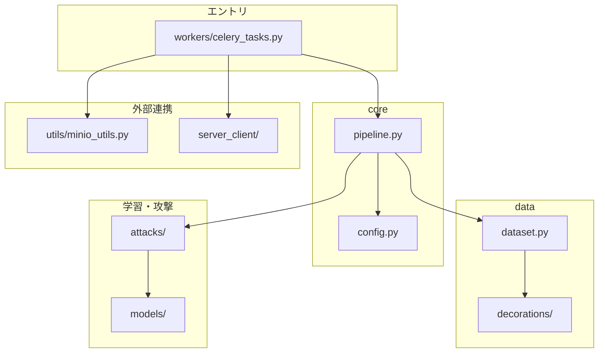


| パス               | 役割                                 |
| ---------------- | ---------------------------------- |
| `core/`          | 環境変数・定数・実験パイプライン                   |
| `data/`          | CIFAR-100 分割・装飾・DataLoader         |
| `models/`        | TargetCNN / AttackNet              |
| `attacks/`       | Offline / Online LiRA / Shokri / LF_MIA / LF_Mult_MIA / LF_Mult_Diff_MIA。`analysis/`（解析・可視化）、`membership_scorers/`（LF_MIA 系の攻撃モデル） |
| `workers/`       | Celery タスク                         |
| `utils/`         | MinIO アップロード・ダウンロード                |
| `server_client/` | 自動生成 API クライアント                    |


---

## ジョブ処理フロー

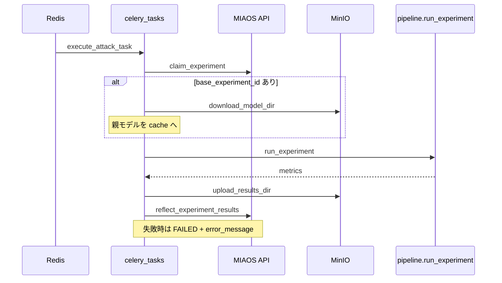

成功時、`metrics` はトップレベル指標と `other_metrics` に分割して API へ送る（`celery_tasks.build_other_metrics` 参照）。

---

## 実験パイプライン（`pipeline.py`）

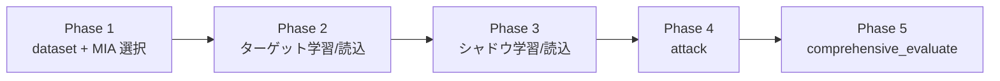

Phase 5 は全手法で ROC / AUC / TPR@FPR を計算する。LF_MIA 系は加えて `attack_score` / `attack_fraction`（各 24 要素リスト）等を metrics に集約する。


| Phase | 内容                                                                                                       |
| ----- | -------------------------------------------------------------------------------------------------------- |
| 1     | `dataset(work_dir, request)` 構築（分割は request のみ参照）、MIA 手法選択（下表）                                      |
| 2     | `train_target_model(model_factory)` で学習、または `load_target_model=True` 時に `assigned_model_path` から読込（LF_MIA 系は 24 体） |
| 3     | シャドウ複数学習、または `load_shadow_model=True` 時に `assigned_model_path` から先頭 `num_shadow_models` 体を読込 |
| 4     | `attack(shadow_models, target_model)` → スコア・参照値（`target_model` の型は手法により単一 / リスト）                    |
| 5     | `comprehensive_evaluate` → metrics 辞書（手法により内容が異なる）                                                      |

### Phase 2: ターゲットモデル

訓練時は全手法で同じ呼び出しを用い、サブクラスの `train_target_model` に委譲する。

```python
target_model = mia_class.train_target_model(lambda: TargetCNN())
```

読込時のみ LF_MIA 系（`LfMia` / `LfMultMia` / `LfMultDiffMia`）と他手法で分岐する。LF_MIA 系の `target_model.pth` は `list[state_dict]`（24 体）、他手法は単一 `state_dict`。

`assigned_model_path` を指定したのに `load_target_model` / `load_shadow_model` / `load_attack_model` がすべて `False` の場合、およびパスが存在しない場合は `ValueError` で即時終了する。`load_attack_model` はこの検証にのみ使われ、攻撃モデルの読込は実装されていない（常に再学習）。


### MIA 手法選択（Phase 1）

| `method`（`MiaMethod`） | クラス               | 前提                                                                 |
| --------------------- | ----------------- | ------------------------------------------------------------------ |
| `OfflineLira`         | `MIA_OfflineLiRA` | —                                                                  |
| `OnlineLira`          | `MIA_OnlineLiRA`  | —                                                                  |
| `Shokri`              | `MIA_Shokri`      | —                                                                  |
| `LfMia`               | `LF_MIA`          | `target_train_decoration`（未指定時は Phase 2 で `ValueError`）/ `attack_decoration`（`watermark` 以外・未指定時は Phase 4 で `ValueError`）が必須。`shadow_decoration` は未指定でもエラーにならないが、IN シャドーが装飾なしになり攻撃が無意味になる |
| `LfMultMia`           | `LF_Mult_MIA`     | `LfMia` と同じ。加えて `attack_decoration` の透かしを target test 画像 K 枚に合成して攻撃。**`hyperparameters.attack_num_images`（K）の指定が必須** |
| `LfMultDiffMia`       | `LF_Mult_Diff_MIA` | `LfMultMia` と同じ。特徴量を「透かしあり − 透かしなし」の logit 差分にする |

`LfMultMia` / `LfMultDiffMia` は `MiaMethod`（OpenAPI 生成ファイル）に手編集で追加している。`make openapi` で再生成すると消えるため、サーバ側スキーマにも同値を追加する必要がある。


`attack()` の戻り値は `(scores, trues)`。`comprehensive_evaluate(scores, trues)` の引数順と一致する。

| 手法            | `attack()` 第2引数 `target_model` | `attack()` 戻り値                         | Phase 5 の主な成果物                                      |
| ------------- | ------------------------------- | -------------------------------------- | --------------------------------------------------- |
| LiRA / Shokri | `nn.Module`（単一）                 | `(np.ndarray, np.ndarray)` スコア配列・真値ラベル | `roc_curve.png`、`global_auc`、TPR@FPR 等               |
| LF_MIA 系（`LfMia` / `LfMultMia` / `LfMultDiffMia`） | `list[nn.Module]`（24 体）          | `(list[float], list[float])` スコア・装飾適用率（各 24 要素）。`attack_score` は membership scorer が K 枚分を集約したスコア（`LfMia` は K=1）。スケールは `membership_score_scale` | `roc_curve.png`（ターゲット単位。fraction>0 を IN、fraction=0 を OUT）、`global_auc`、TPR@FPR 等、`attack_score` / `attack_fraction`。Phase 4 中に `roc_curve_all_scores.png`、`attack_score_distribution/`、`target_attacksign_output/`、`shadow_pair_effect/`、（`neural` のみ）`analyze_attack_model/`、（`neural_regularized` のみ）`neural_regularized_cv/`、（`lightgbm` のみ）`lightgbm_cv/`、（`svm` のみ）`svm_cv/`、（`flat_svm` のみ）`flat_svm_cv/`、（`svm` / `flat_svm` のみ）`svm_decision_analysis/` を出力 |


ログ: `work_dir/execution.log` + stdout

---

## `data/` — 責務分担

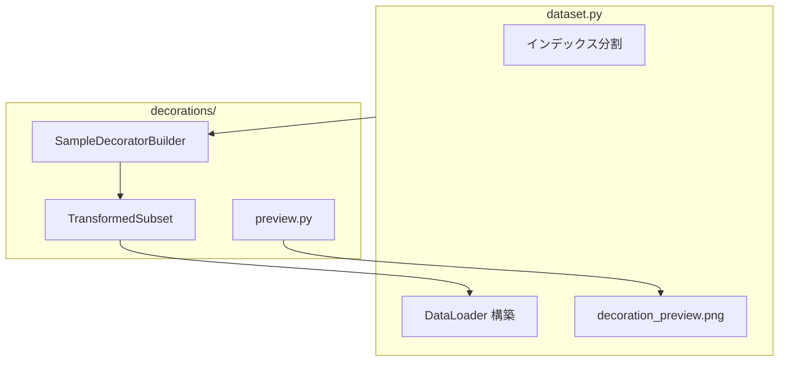


| モジュール          | 責務                                     |
| -------------- | -------------------------------------- |
| `dataset.py`   | CIFAR 分割、`get_*_dataloaders`、装飾プレビュー保存、`get_attack_watermark_dataloader` / `get_attack_composite_dataloaders`（薄いファサード） |
| `decorations/` | 装飾設定パース・適用・透かし I/O・黒背景透かし画像生成・K 枚合成テンソル生成 |


`dataset` は透かしの MinIO 取得や PIL 合成を**持たない**。黒背景 1 枚は `watermark/watermark_on_black.py`、K 枚合成は `watermark/composite.py` に委譲する。インデックス選定と DataLoader の組み立ては `dataset` が担当する。

---

## データ分割

`dataset.json` は使わない。毎回 `CreateExperimentRequest` の入力から分割を再計算する。

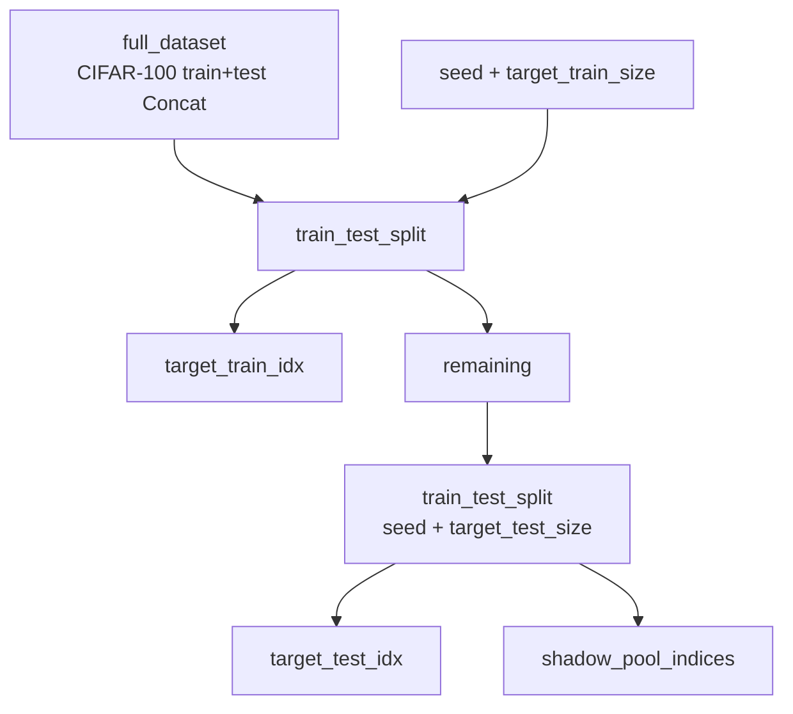


シャドウ分割は `shadow_pool_indices` から `seed + i` で毎シャドウ再計算（`dataset.json` に保存しない）。

### `base_experiment_id` の契約

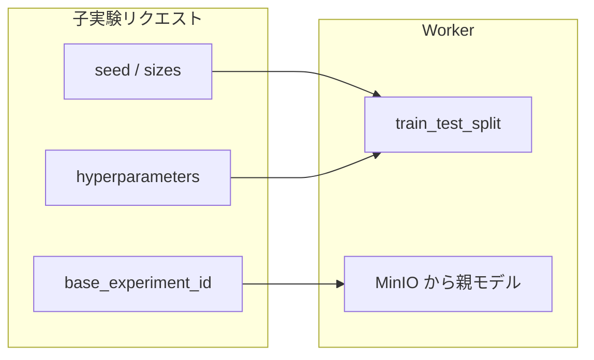


親モデル流用時、呼び出し側が親と**同じ `seed` / `target_train_size` / `target_test_size`** を指定することで同一分割を再現する。Worker は親パラメータを API から取得しない。

### DataLoader 対応

| メソッド | 用途 | transform | shuffle |
| -------- | ---- | --------- | ------- |
| `get_target_dataloaders(decoration_spec=None)` | ターゲット学習。`decoration_spec` 省略時は `target_train_decoration` | `transform_train` / `transform_test` | train のみ `True` |
| `get_shadow_dataloader(seed, decoration_spec=None)` | シャドー学習（Offline LiRA / Shokri / LF_MIA 系）。`decoration_spec` を train / test に適用する（`None` は装飾なし。LF_MIA の IN シャドーのみ指定） | 同上 | train のみ `True` |
| `get_online_lira_shadow_dataloader(seed, query_indices, query_keep)` | Online LiRA シャドー学習。shadow pool 分割に keep=True のクエリサンプルを加える（装飾なし） | 同上 | train のみ `True` |
| `get_eval_target_dataloaders` / `get_eval_shadow_dataloader` | 攻撃評価（Shokri / LiRA）。`eval_decoration` を適用 | `transform_test` | `False` |
| `get_attack_watermark_dataloader` | LF_MIA 攻撃用透かし 1 枚 | `transform_test` | `False`（`batch_size=1`） |
| `get_attack_composite_dataloaders(num_images)` | LF_Mult_MIA 系。target test から K 枚を選び、透かし合成済み / 素の画像の 2 loader を返す | `transform_test` | `False`（`batch_size=K`） |

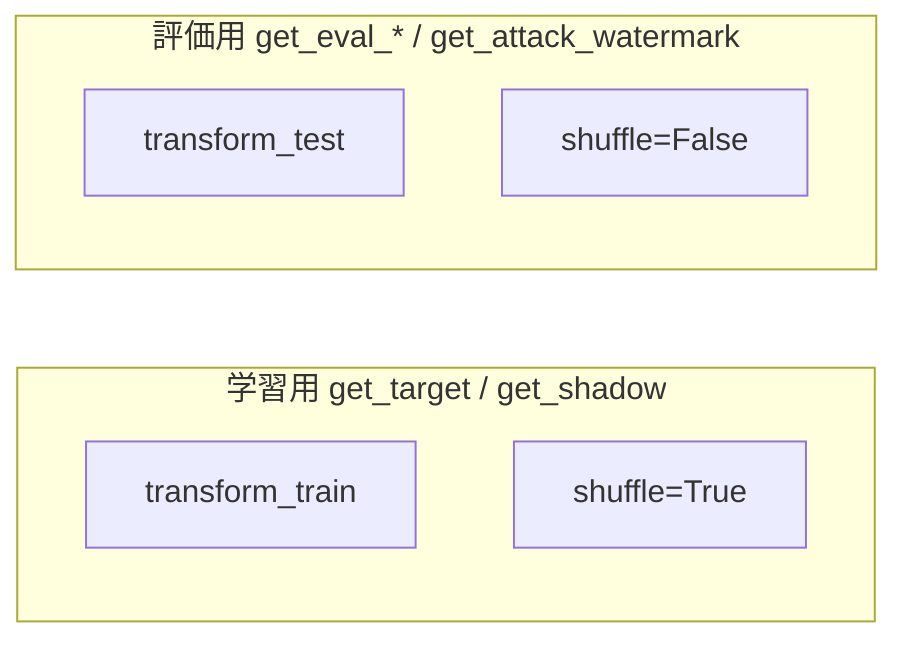


---

## `data/decorations/` — サンプル装飾

設定の唯一の経路: `hyperparameters.eval_decoration` / `target_train_decoration` / `shadow_decoration` / `attack_decoration`  
1 サンプルに同時適用する装飾は 1 種類。Normalize 前の PIL 段階で適用。  
`hyperparameters` の全キー（装飾オブジェクトのフィールド・制約を含む）は [`HYPERPARAMETERS.md`](HYPERPARAMETERS.md) を参照。

### モジュール構成

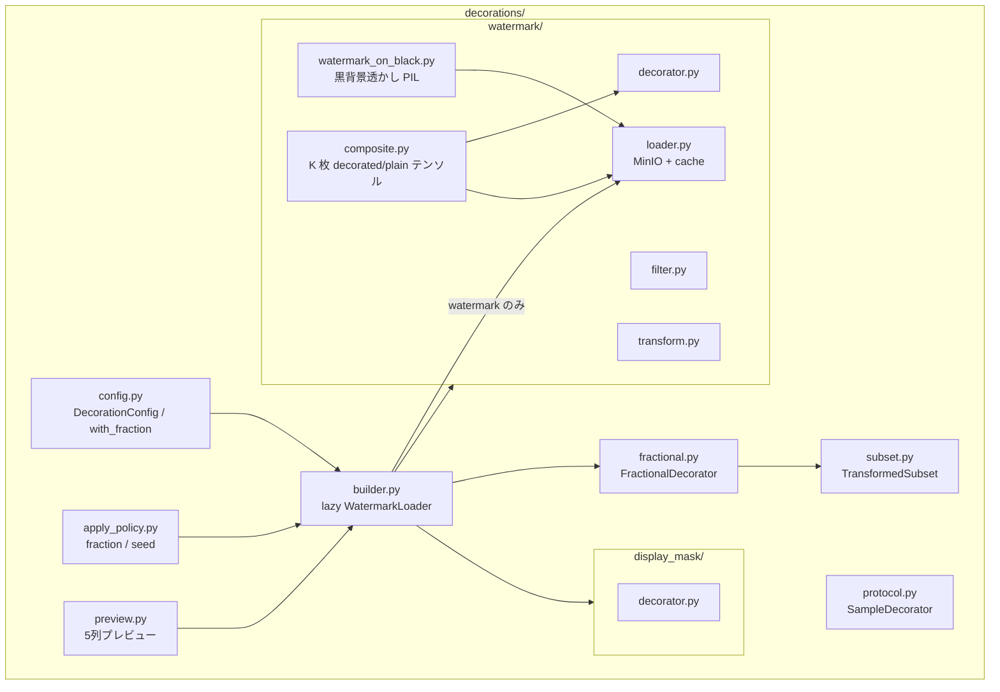


### `WatermarkLoader` の lazy 初期化

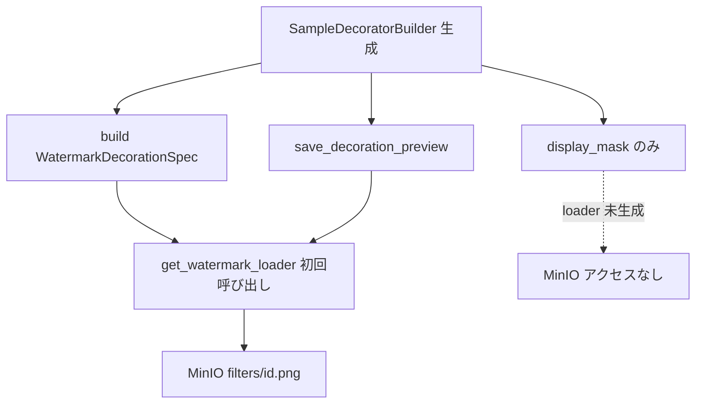


透かし装飾が不要な実験では `WatermarkLoader` は作られない。

### 装飾パイプライン

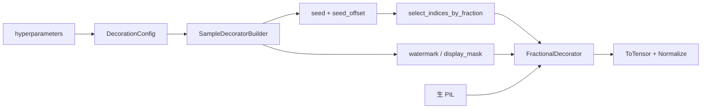


### 設定例

```json
{
  "eval_decoration": {"type": "watermark", "filter_id": "circle", "fraction": 1.0},
  "target_train_decoration": {
    "type": "display_mask",
    "width": 16, "height": 16, "position": [0, 0],
    "fraction": 0.5, "seed_offset": 0
  },
  "shadow_decoration": {"type": "watermark", "filter_id": "circle", "fraction": 1.0},
  "attack_decoration": {"type": "watermark", "filter_id": "circle", "fraction": 1.0}
}
```


| キー                        | 適用先                                                          |
| ------------------------- | ------------------------------------------------------------ |
| `eval_decoration`         | `get_eval_target_dataloaders` / `get_eval_shadow_dataloader` / `get_eval_decorated_sample`（LiRA / Shokri。LF_MIA 系では不使用） |
| `target_train_decoration` | `get_target_dataloaders` の train（全手法）。LF_MIA 系では装飾種別（`filter_id` 等）のベース spec。`apply.fraction` は固定リストで上書き（下記 LF_MIA） |
| `shadow_decoration`       | LF_MIA: IN シャドーの学習・テストデータ（`get_shadow_dataloader(..., decoration_spec=)`）。`shadow_fraction_sweep=true` では `apply.fraction` を IN シャドーごとの適用率で上書き（下記） |
| `attack_decoration`       | `get_attack_watermark_dataloader`（LF_MIA の攻撃用透かし 1 枚。`watermark` のみ）/ `get_attack_composite_dataloaders`（LF_Mult_MIA 系の合成透かし。`watermark` のみ） |

### `get_attack_watermark_dataloader`（`dataset.py`）

`attack_decoration` の `filter_id` で黒背景透かし PIL を 1 枚生成し、`transform_test` 適用後 `(1, 3, H, W)` の `DataLoader`（`batch_size=1`）として返す。`MIA_Attack.get_predictions` と組み合わせて LF_MIA の特徴抽出・ターゲット推論に使う。正解ラベルは持たないためダミー `0` を付与。

### `get_attack_composite_dataloaders(num_images)`（`dataset.py`）

`target_test_idx` から `RandomState(seed)` で K 枚を非復元抽出し、取得した PIL 画像リストを `watermark/composite.py` の `build_decorated_plain_tensors` に渡す。透かし合成（`WatermarkDecorator` 経由の alpha ブレンド）と `transform_test` 適用は `composite` 側で行い、`dataset` は返却テンソルを `DataLoader`（`batch_size=K`, `shuffle=False`）に載せるだけである。

- decorated: 透かし合成済み `(K, 3, H, W)`
- plain: 素の画像 `(K, 3, H, W)`（順序は decorated と同一）

target test はターゲット・シャドー双方の訓練データと重複しないため、合成のベース画像として用いてもメンバーシップ情報を持ち込まない。`num_images` が target test サイズを超える場合はエラー。`attack_decoration` は `watermark` 型のみ。

### LF_MIA における `shadow_decoration`

`LF_MIA.train_shadow_models` はシャドーを IN / OUT の 2 群に分けて学習する。

| 群       | 件数                      | データ取得                                              |
| ------- | ----------------------- | -------------------------------------------------- |
| IN シャドー | `num_shadow_models / 2` | `get_shadow_dataloader(seed=i, decoration_spec=with_fraction(shadow_decoration, f_i))`  |
| OUT シャドー | 同上                      | `get_shadow_dataloader(seed=i)` |

IN シャドーのみ `shadow_decoration` が train / test 双方に適用される。IN シャドー i と OUT シャドー i は同じ `seed=i` でデータ分割を共有し、違いは装飾の有無と初期化・SGD の乱数のみ（ペア設計）。

IN シャドー i の適用率 `f_i` は `ShadowFractionSweep`（`attacks/shadow_fraction_sweep.py`。`hyperparameters.shadow_fraction_sweep`）が決める。

| `shadow_fraction_sweep` | `f_i` |
| ----------------------- | ----- |
| `false`（既定） | `shadow_decoration.fraction`（全ペア共通。従来どおり） |
| `true` | `SHADOW_IN_FRACTIONS[i % 10]`（`1.0, 0.9, ..., 0.1`）。`n_pairs` が 10 の倍数でない場合と `shadow_decoration` 未指定の場合は `ValueError` |

`f_i` はインスタンスに保持せず `LF_MIA._shadow_in_fractions()` が設定から決定的に求める（`load_shadow_model` でシャドーを読み込む場合も同じ値になる）。`_collect_shadow_features` は特徴と `f_i` を `ShadowPairFeatures(in_feats, out_feats, in_fractions)` にまとめて scorer に渡す。

LiRA / Shokri のシャドー学習データには装飾を適用しない（`get_shadow_dataloader(seed)` / `get_online_lira_shadow_dataloader`）。


| `type`         | パラメータ                                                                         |
| -------------- | ----------------------------------------------------------------------------- |
| `watermark`    | `filter_id`, `fraction`（省略時 1.0）, `seed_offset`（省略時 0）                        |
| `display_mask` | `width`（省略時 16）, `height`（省略時 16）, `position`（`[x,y]` / `{x,y}`、または `x`/`y`。省略時 `(0, 0)`）, `fraction`, `seed_offset` |


**適用ポリシー（全装飾共通）**

- `fraction` / `seed_offset` は装飾オブジェクトの直下に書く（内部では `DecorationSpec.apply` に格納）
- `with_fraction(spec, fraction)` — `DecorationSpec` の `apply.fraction` だけを上書き（LF_MIA のターゲット学習スイープで使用）
- 選定シード: `experiment.seed + seed_offset`
- 同じ `fraction` + `seed_offset` + 同じ pool → type が違っても同一サンプルに適用
- 透かしフィルタ: `WatermarkLoader` が MinIO `filters/{filter_id}.png` を `./cache/filters/` に取得
- デバッグ: `work_dir/decoration_preview.png`（左から plain / target / eval / shadow / attack の5列。未設定列は plain と同一）

`CreateExperimentRequest.watermark`（トップレベル）は**無視**。装飾は `hyperparameters` のみ。

---

## `attacks/` — MIA 手法

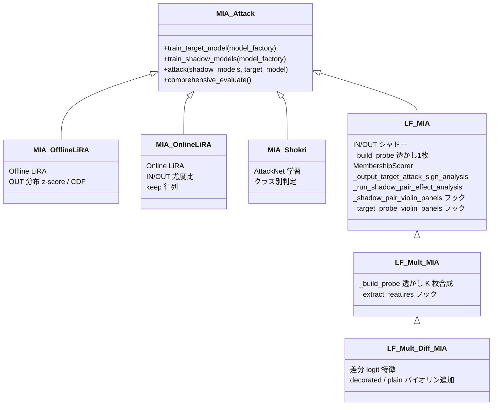


| クラス               | 概要                                             |
| ----------------- | ---------------------------------------------- |
| `MIA_Attack`      | 学習・予測・ROC 共通基底                                 |
| `MIA_OfflineLiRA` | シャドウ OUT 分布から z-score → CDF スコア（論文 Equation 4） |
| `MIA_OnlineLiRA`  | シャドウ IN/OUT 分布から対数尤度比スコア（論文 Algorithm 1）       |
| `MIA_Shokri`      | ソフトマックス特徴 → `AttackNet`（クラス別。エポック数は `cfg.ATTACK_MODEL_EPOCHS` 固定）                  |
| `LF_MIA`          | 装飾あり/なしシャドー + 攻撃用透かし（黒背景 1 枚, K=1）→ membership scorer。ターゲットは装飾適用率 24 体（`LF_MIA_TARGET_FRACTIONS`）で学習・攻撃。攻撃末尾でシャドー IN/OUT ペア効果量解析（`shadow_pair_effect/`）を出力     |
| `LF_Mult_MIA`     | `LF_MIA` 派生。プローブを「透かしを target test 画像 K 枚に合成したもの」に差し替える（`_build_probe` のオーバーライド）。学習・集約は membership scorer が担う |
| `LF_Mult_Diff_MIA` | `LF_Mult_MIA` 派生。特徴量を `logit(透かしあり) − logit(透かしなし)` の差分にして画像固有成分を打ち消す |


### LF_MIA（`lf_mia.py`）

#### ターゲットモデル（Phase 2）

LF_MIA は `target_train_decoration.apply.fraction` を無視し、固定の装飾適用率リストでターゲットモデルを 24 体学習する。装飾種別（`filter_id`, `seed_offset` 等）は `target_train_decoration` をベースに、`config.with_fraction` で fraction だけ上書きする。

```python
LF_MIA_TARGET_FRACTIONS = [
    1.0, 0.9, 0.8, 0.7, 0.6, 0.5, 0.4, 0.3, 0.2, 0.1, 0.01, 0.001,  # IN（12 体）
    0.0, 0.0, 0.0, 0.0, 0.0, 0.0, 0.0, 0.0, 0.0, 0.0, 0.0, 0.0,     # OUT（12 体）
]
```

`LF_MIA.train_target_model(model_factory)` が基底 `MIA_Attack.train_target_model` をオーバーライドし、各 fraction で `get_target_dataloaders(decoration_spec=...)` を呼んで学習する。戻り値は `list[nn.Module]`（24 体）。`target_model.pth` には `list[state_dict]` を保存する。

- 全ターゲットは同じ学習データ（`target_train_idx`）を使う。違いは装飾適用率と初期化シードのみ。
- 初期化シード: fraction>0 の 12 体はすべて `seed`（同一初期重み）。fraction=0 は n 体目（0 始まり）が `seed + n`（1 体目は `seed`）。
- 評価ラベル: fraction>0 を IN（1）、fraction=0 を OUT（0）とする。

#### 攻撃（Phase 4）

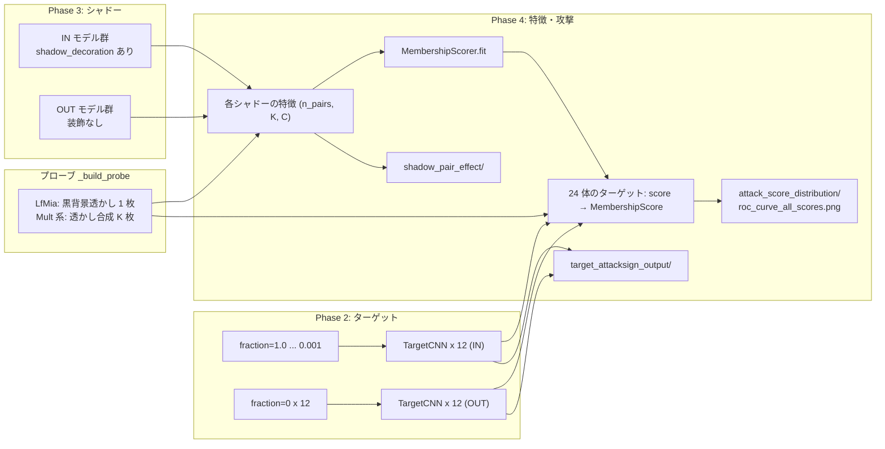

1. `_build_probe()` がモデル 1 体から特徴 `(K, NUM_CLASSES)` を返す callable を作る。`LF_MIA` は `get_attack_watermark_dataloader`（黒背景透かし 1 枚, K=1）の softmax に `logit_scaling` を適用する。Mult 系は下記。
2. `_collect_shadow_features` で IN / OUT シャドーの特徴 `(n_pairs, K, NUM_CLASSES)` と IN シャドーの適用率 `(n_pairs,)` を `ShadowPairFeatures` として得る（シャドーは IN, OUT の順で半々。`n_pairs = num_shadow_models / 2`）。
3. `hyperparameters.membership_scorer` で選んだ membership scorer（下記）を **1 回** `fit(features)` する。`neural` の場合のみ `analyze_attack_model/` と `attack_models.pth` / `attack_model_init.pth` を出力する。
4. 24 体のターゲットそれぞれで同じプローブの特徴を取り、`scorer.score(feats)` が `MembershipScore(value, per_image)` を返す。
   - `attack_score`: `value`（スコアラーが K 枚分を集約したスコア。長さ 24 のリスト）
   - `attack_scores_vars`: `per_image` の標本分散（K=1 のときは 0.0）
   - `attack_fraction`: `LF_MIA_TARGET_FRACTIONS` の対応値（装飾適用率。評価時に fraction>0 を IN とみなす）
5. `per_image` を `attack_score_distribution/` に出力し（下記）、全ターゲットの `per_image` を展開した ROC（各値にそのターゲットのラベルを付与）を `roc_curve_all_scores.png` と `all_scores_*` metrics に出力する。
6. `_output_target_attack_sign_analysis` で 24 体のターゲットそれぞれに `get_attack_watermark_dataloader` の透かし 1 枚を再入力し、softmax 確率を `target_attacksign_output/` に保存する（下記）。LF_MIA 系全手法で同一。続けて `_run_target_probe_violin_analysis` で、手順 4 のターゲット特徴のクラス別バイオリン図を同じディレクトリに出力する（K>=2 のみ。下記）。
7. `attack()` 最末尾で `_run_shadow_pair_effect_analysis` を呼び、シャドー IN/OUT ペアのクラス別装飾効果量を `shadow_pair_effect/` に出力する（下記）。続けて `_run_shadow_pair_violin_analysis` でプローブ特徴のクラス別バイオリン図を同じディレクトリに出力する（下記）。いずれも攻撃スコアには影響しない。

Phase 5 の `comprehensive_evaluate` は `attack_score` と「fraction>0 を IN（1）、fraction=0 を OUT（0）」としたラベルで ROC を計算し、`roc_curve.png` と `global_auc` / `tpr_at_*_fpr` / `threshold_at_*_fpr` を出力する。閾値の単位は `membership_score_scale` に従う。

ハイパーパラメータは [`HYPERPARAMETERS.md`](HYPERPARAMETERS.md) を参照。

保存物:

| ファイル / ディレクトリ | 内容 |
| -------- | ---- |
| `target_model.pth` | LF_MIA 系: `list[state_dict]`（24 体）。他手法: 単一 `state_dict` |
| `shadow_models.pth` | 全シャドーの `list[state_dict]`（IN, OUT の順） |
| `attack_models.pth` | （`neural` のみ）攻撃モデル 1 体の `state_dict` |
| `attack_model_init.pth` | （`neural` のみ）攻撃モデル訓練前の初期重み（`analyze_attack_model` の差分ベースライン） |
| `analyze_attack_model/` | （`neural` のみ）攻撃モデル解析結果（重みヒートマップ・クラス重要度・入力感度等の PNG + `summary.json`） |
| `neural_regularized_cv/` | （`neural_regularized` のみ）`trials.csv`（Optuna 全 trial）、`best_params.json`（最良 trial のハイパーパラメータと CV スコア）、`folds.json`（最良 trial の fold ごとのスコア・best epoch・ペア分割と各ペアの IN 適用率 `train_fractions` / `val_fractions` / `test_fractions`） |
| `lightgbm_cv/` | （`lightgbm` のみ）`neural_regularized_cv/` と同じ構成。`best_params.json` には `patience` / `max_rounds` も含み、`folds.json` の反復数キーは `best_iteration`（採用したブースティングラウンド数） |
| `svm_cv/` | （`svm` のみ）`neural_regularized_cv/` と同じ構成。`best_params.json` には `kernel` / `standardize` / `rbf_n_components` / `max_iter` も含む。早期停止しないため `folds.json` に反復数のキーは無い |
| `flat_svm_cv/` | （`flat_svm` のみ）`svm_cv/` と同じ構成。`best_params.json` の scorer 固有の設定は `kernel` / `standardize` |
| `svm_decision_analysis/` | （`svm` / `flat_svm` のみ）`pca_scatter.png`、`decision_histogram.png`、`summary.json`（学習済みモデルの可視化。`HYPERPARAMETERS.md` 参照） |
| `roc_curve.png` | ターゲット単位（`attack_score`）の ROC |
| `roc_curve_all_scores.png` | 画像ごとのスコア（`per_image`）全体の ROC |
| `attack_score_distribution/` | `scores.json`（全ターゲット）。K>=2 のときのみ `histogram_overlay.png` / `histogram_facet.png` / `violin.png` |
| `target_attacksign_output/` | ターゲットモデルへの攻撃透かし入力時のクラス別確率棒グラフ + `summary.json`。K>=2 ではターゲットのプローブ特徴バイオリン図（`probe_fraction_*_violin.png`、13 枚）も含む |
| `shadow_pair_effect/` | シャドー IN/OUT ペア効果量解析（PNG 4 枚 + `summary.json`）とクラス別バイオリン図（`*_violin.png`。`LF_MIA` / `LF_Mult_MIA` は 3 枚、`LF_Mult_Diff_MIA` は 7 枚）。下記 |

metrics には ROC 指標・`attack_score` / `attack_fraction` に加えて、`target_train_accs` / `target_test_accs` / `target_acc_gaps`、`shadow_train_accs` / `shadow_test_accs` / `shadow_acc_gaps`、`membership_scorer` / `membership_score_scale`、`shadow_fraction_sweep` / `shadow_in_fractions`（IN シャドーごとの装飾適用率）、スコアラーの diagnostics、`attack_scores_vars`、`all_scores_auc` / `all_scores_tpr_at_*_fpr` / `all_scores_threshold_at_*_fpr`、シャドー IN/OUT ペア効果量解析由来の `shadow_pair_global_permutation_pvalue` / `shadow_pair_num_significant_fdr` を格納する。

スコアラーの diagnostics:

| `membership_scorer` | キー |
| ------------------- | ---- |
| `neural` | `w1_relative_change`, `attack_model_train_acc` / `attack_model_train_loss` / `attack_model_train_in_acc` / `attack_model_train_out_acc` |
| `neural_regularized` | `cv_objective`, `standardize`, `cv_score` / `cv_fold_mean` / `cv_fold_std`, `best_trial_number`, `best_lr` / `best_weight_decay` / `best_n_hidden` / `best_hidden_dim`（0 層時 `null`）/ `best_dropout`, `best_epoch_median`, `n_trials_completed` / `n_trials_pruned` |
| `lightgbm` | `cv_objective`, `cv_score` / `cv_fold_mean` / `cv_fold_std`, `best_trial_number`, `best_learning_rate` / `best_num_leaves` / `best_max_depth`（無制限時 `-1`）/ `best_min_child_samples` / `best_feature_fraction` / `best_bagging_fraction` / `best_lambda_l1` / `best_lambda_l2`, `best_iteration_median`, `n_trials_completed` / `n_trials_pruned` |
| `svm` | `cv_objective`, `svm_kernel`, `standardize`, `cv_score` / `cv_fold_mean` / `cv_fold_std`, `best_trial_number`, `best_C` / `best_gamma_factor`（`linear` 時 `null`）, `n_trials_completed` / `n_trials_pruned` |
| `flat_svm` | `svm` と同じ（`svm_kernel` の代わりに `flat_svm_kernel`） |
| `diagonal_lda` | `diagonal_lda_reg_lambda`, `diagonal_lda_variance`, `diagonal_lda_w_norm`, `diagonal_lda_b`, クラス選択共通キー |
| `flat_diagonal_lda` | `flat_diagonal_lda_reg_lambda`, `flat_diagonal_lda_variance`, `flat_diagonal_lda_w_norm`, `flat_diagonal_lda_b`, `flat_diagonal_lda_w_norm_per_image`（K 要素リスト）, クラス選択共通キー |
| `gaussian_lr` | `gaussian_lr_variance`, `gaussian_lr_var_floor`, `gaussian_lr_floored_ratio_in` / `gaussian_lr_floored_ratio_out`（クラス選択に依らず全次元で算出）, クラス選択共通キー |

クラス選択共通キー: `significant_class_selection`, `num_selected_classes`, `class_selection_fallback`（有意クラス 0 件で全クラスに戻したか）。

#### 攻撃スコア分布（`analysis/attack_score_distribution.py`）

出力先は `MODEL_SAVE_DIR/attack_score_distribution/`（`config.ATTACK_SCORE_DISTRIBUTION_DIR`）。

- `scores.json`: `scale`（`probability` / `log_odds`）と、ターゲットごとの `label` / `fraction` / `score`（集約スコア）/ `mean` / `var` / `scores`（`per_image`）
- 図（全ターゲットで K>=2 のときのみ）: 重ね描きヒストグラム、Facet ヒストグラム、バイオリンプロット。破線・黒バーは `per_image` の平均。横軸は `probability` なら `[0, 1]`、`log_odds` なら全値の範囲に余白を付けたもの
- 配色: IN（fraction>0）は fraction の降順に濃い赤から淡い赤、OUT（fraction=0）は青

#### 攻撃モデル解析（`analysis/attack_model_analysis.py`）

`membership_scorer=neural` のとき、`NeuralMembershipScorer.fit` 内で `AttackNet` 訓練後に `analyze_attack_model` を呼び出す。出力先は `MODEL_SAVE_DIR/analyze_attack_model/`（`config.ATTACK_MODEL_ANALYSIS_DIR`）。

- 学習済み重みのスナップショット（`weight_heatmap.png`, `class_importance.png` 等）
- 初期重みとの差分（`delta_*.png`）
- 学習データ `attack_x` / `attack_y` 上の到達度・入力勾配（`input_gradient_*.png` 等）
- `summary.json`（重みサマリ・fit 指標・入力感度サマリ）

#### ターゲット攻撃透かし出力の可視化（`analysis/target_attack_sign_output.py`）

`LF_MIA._output_target_attack_sign_analysis` が Phase 4（攻撃スコア計算・スコア分布出力の後）で呼ばれる。LF_MIA 系全手法で同一実装を継承する。出力先は `MODEL_SAVE_DIR/target_attacksign_output/`（`config.TARGET_ATTACKSIGN_OUTPUT_DIR`）。

- 入力: `get_attack_watermark_dataloader` の透かし 1 枚（攻撃特徴抽出とは別経路。Mult 系でも composite loader は使わない）
- 各ターゲットモデルで `MIA_Attack.get_predictions` → softmax 確率 `(NUM_CLASSES,)`
- PNG: `class_probabilities_fraction_{fraction}.png`（fraction の `.` を `_` に置換。例: `1.0` → `1_0`）。ファイル名は fraction のみで決まるため、fraction=0 の 12 体は同じ `class_probabilities_fraction_0_0.png` に上書きされ、最後の 1 体分だけが残る（PNG は計 13 枚）
- `summary.json`: 24 体分の `fraction` / `probs`（100 要素）/ `argmax_class` / `argmax_value` / `top_classes`（上位 10 クラス）/ `plot_path`
- 描画スタイルは `attack_model_analysis.plot_class_importance` を再利用（`figsize=(16,5)`, `dpi=300`）

#### ターゲットのプローブ特徴のバイオリン図

`LF_MIA._run_target_probe_violin_analysis` が `_output_target_attack_sign_analysis` の直後に呼ばれる。出力先は同じ `MODEL_SAVE_DIR/target_attacksign_output/` で、描画は `analysis/probe_violin.py`（後述）。

- 入力は攻撃ループで得たターゲットごとのプローブ特徴 `(K, NUM_CLASSES)`（攻撃特徴そのもの。再推論はしない）
- K>=2 の手法のみ（`LF_Mult_MIA` / `LF_Mult_Diff_MIA`）。`LF_MIA`（K=1）では出力しない
- パネル構成はテンプレートメソッド `_target_probe_violin_panels(fractions, target_feats) -> list[ProbeViolinPanel]` で決まる。fraction>0 は 1 体ずつ `(1, K, C)`、fraction=0 の 12 体はまとめて `(12, K, C)` の 1 枚（計 13 枚）
- PNG: `probe_fraction_{fraction}_violin.png`（fraction の表記は `class_probabilities_fraction_*` と同じ `fraction_to_filename`）

| 手法 | 値 | 下段 |
| ---- | -- | ---- |
| `LF_Mult_MIA` | `logit(decorated)` | なし |
| `LF_Mult_Diff_MIA` | `logit(decorated) − logit(plain)` | 0 に対する 1 標本 Wilcoxon。fraction>0 は `IMAGE_LEVEL`（K 点）、fraction=0 は `MODEL_LEVEL`（12 点） |

#### シャドー IN/OUT ペア効果量解析（`analysis/shadow_pair_effect_analysis.py`）

`LF_MIA._run_shadow_pair_effect_analysis` が Phase 4 末尾（`_output_target_attack_sign_analysis` の後）で呼ばれる。LF_MIA 系全手法で同一フックを使用する。出力先は `MODEL_SAVE_DIR/shadow_pair_effect/`（`config.SHADOW_PAIR_EFFECT_DIR`）。membership scorer には依存しないモデル非依存の診断。

**ペア設計**: `train_shadow_models` は `seed=i` で IN シャドー i と OUT シャドー i の訓練サブセットを揃える。各ペアに同じプローブを入力し、クラス c ごとの差分 `mean(IN[:,c] - OUT[:,c])` を装飾効果の推定量とする。

**特徴**: 攻撃本体で `_collect_shadow_features` が抽出した `(n_pairs, K, NUM_CLASSES)` を **K 方向に平均**して `(n_pairs, NUM_CLASSES)` とする（再推論はしない）。

| 手法 | プローブ | 1 シャドーあたりの特徴 |
| ---- | -------- | ---------------------- |
| `LF_MIA` | `get_attack_watermark_dataloader`（黒背景透かし 1 枚, K=1） | `logit_scaling(softmax)` → `(NUM_CLASSES,)` |
| `LF_Mult_MIA` | `get_attack_composite_dataloaders(K)` の透かし合成 K 枚 | `_extract_features` → `(K, NUM_CLASSES)` の K 枚平均 → `(NUM_CLASSES,)` |
| `LF_Mult_Diff_MIA` | 同上 | 差分特徴 `logit(透かしあり) − logit(透かしなし)` の K 枚平均 |

Wilcoxon 等の統計単位は `n_pairs = num_shadow_models / 2` とする。

**統計量**（クラス c ごと）:

| 量 | 定義 |
| -- | ---- |
| `mean_diff[c]` | `mean(IN[:,c] - OUT[:,c])` |
| `cohens_d[c]` | ペア差分の Cohen's d（`std=0` なら `null`） |
| `wilcoxon_p[c]` | 両側 Wilcoxon 符号順位検定（`n_pairs < 6` または全ゼロなら `null`） |
| Bonferroni 有意 | `wilcoxon_p * n_classes < alpha` |
| BH-FDR 有意 | Benjamini–Hochberg（`alpha=0.05`） |
| `global_permutation_p` | `T_obs = max_c \|mean_diff[c]\|` に対する符号反転置換検定（`config.SHADOW_PAIR_N_PERMUTATIONS` 回） |

**出力ファイル**:

| ファイル | 内容 |
| -------- | ---- |
| `summary.json` | 下記スキーマ |
| `mean_diff_bar.png` | クラス別 `mean_diff`（正=IN 方向、負=OUT 方向） |
| `cohens_d_bar.png` | クラス別 Cohen's d |
| `wilcoxon_neglog10_p_bar.png` | `-log10(wilcoxon_p)`。Bonferroni 実線・BH-FDR 破線の有意閾値線付き |
| `volcano.png` | x=`mean_diff`、y=`-log10(wilcoxon_p)`。Bonferroni/FDR 水平線付き |

`wilcoxon_p` が `null` のクラスは Wilcoxon 系グラフでは非表示。

**`summary.json` スキーマ**:

```json
{
  "n_pairs": 50,
  "alpha": 0.05,
  "n_permutations": 9999,
  "global_permutation_p": 0.001,
  "top_class_by_abs_cohens_d": 42,
  "top_class_cohens_d": 1.23,
  "significant_class_ids_bonferroni": [42, 7],
  "significant_class_ids_fdr": [42, 7, 15],
  "classes": {
    "0": {"mean_diff": 0.01, "cohens_d": 0.05, "wilcoxon_p": 0.82},
    ...
  }
}
```

**metrics**（`other_metrics` へ自動収集。2 キーのみ）:

| キー | 意味 |
| ---- | ---- |
| `shadow_pair_global_permutation_pvalue` | グローバル置換検定 p 値 |
| `shadow_pair_num_significant_fdr` | BH-FDR 有意クラス数（主指標） |

クラス別の詳細数値・`n_pairs`・`top_class_cohens_d`・Bonferroni 有意クラス一覧は `summary.json` のみ（metrics には載せない）。

#### プローブ特徴のクラス別バイオリン図（`analysis/probe_violin.py`）

シャドー IN/OUT（下記）とターゲット（後述）で共用する描画。`save_violin_panels(panels, output_dir, alpha=0.05)` が各パネルを `{name}_violin.png` として保存する。metrics には何も載せない。

- `ProbeViolinPanel`（frozen）: `name` / `title` / `ylabel` / `values (n_models, K, NUM_CLASSES)` / `significance: SignificanceTest`。`per_image()` は `(n_models × K, NUM_CLASSES)`、`per_model()` は K 枚平均の `(n_models, NUM_CLASSES)`、`test_samples()` は `significance` に応じた検定用標本を返す。
- `SignificanceTest`: `NONE`（下段なし）/ `MODEL_LEVEL`（`per_model`。同一モデル内の K 枚は独立でないため、複数モデルではこちら）/ `IMAGE_LEVEL`（`per_image`。1 モデルを固定した条件付き検定。単一ターゲット用）。
- 上段: 100 クラスのバイオリンを 1 枚に描く。分布は全画像の値（`per_image`）。各クラスの平均を短い横線で示す（正=赤、負=青）。
- 下段（`significance` が `NONE` 以外のパネルのみ。x 軸共有）: `test_samples()` の各クラスに対する両側 Wilcoxon 符号順位検定（0 に対する）の `-log10(p)` 棒グラフ。Bonferroni（`alpha / n_classes`）実線と BH-FDR 閾値破線（`alpha=0.05`）付き。y ラベルに検定単位（`model-level (K-mean)` / `image-level (K images)`）を明記する。標本数 6 未満または全ゼロのクラスは非表示（効果量解析と同じ `class_wilcoxon_pvalues` を使用）。

#### シャドー IN/OUT プローブ特徴のバイオリン図

`LF_MIA._run_shadow_pair_violin_analysis` が `_run_shadow_pair_effect_analysis` の直後に呼ばれる。出力先は効果量解析と同じ `MODEL_SAVE_DIR/shadow_pair_effect/`（`config.SHADOW_PAIR_EFFECT_DIR`）。

- パネル構成はテンプレートメソッド `_shadow_pair_violin_panels(shadow_models, in_feats, out_feats) -> list[ProbeViolinPanel]` で決まる。縦軸ラベルは `_probe_feature_label()`（既定 `logit(p)`）。
- 検定はすべて `MODEL_LEVEL`（`n_pairs` 点）。

| `name` | 値 | 下段 | `LF_MIA` / `LF_Mult_MIA` | `LF_Mult_Diff_MIA` |
| ------ | -- | ---- | ------------------------ | ------------------ |
| `in` | IN シャドーのプローブ特徴 | `LF_Mult_Diff_MIA` のみ（decorated − plain の 0 に対する 1 標本検定） | o | o（decorated − plain） |
| `out` | OUT シャドーのプローブ特徴 | 同上 | o | o（decorated − plain） |
| `in_minus_out` | 同一 seed ペアの差分 IN − OUT | あり（paired 検定） | o | o |
| `in_decorated` / `in_plain` | IN シャドーの `logit_scaling(softmax(透かしあり / 透かしなし))` | なし | - | o |
| `out_decorated` / `out_plain` | OUT シャドーの同上 | なし | - | o |

`LF_Mult_Diff_MIA` の decorated / plain は、攻撃経路に手を入れないようフック内で `get_attack_composite_dataloaders(K)` を再取得して再推論する（K 枚の選択は `seed` で決定的なため、攻撃と同じ K 枚になる）。

### LF_Mult_MIA / LF_Mult_Diff_MIA（`lf_mult_mia.py` / `lf_mult_diff_mia.py`）

`LF_MIA` を継承し、Phase 2 / 3 と `attack()` 本体はそのまま再利用する。`_build_probe`（プローブ = 入力画像の作り方）と `_extra_attack_metrics` のみ置き換える（`LF_Mult_Diff_MIA` は加えて解析用の `_probe_feature_label` / `_shadow_pair_violin_panels` / `_target_probe_violin_panels` をオーバーライドする。上記バイオリン図参照）。

1. `_build_probe` で `get_attack_composite_dataloaders(K)` から透かし合成済み / 素の画像 K 枚の loader を取得する（K は `hyperparameters.attack_num_images`。**必須**）。
2. `_extract_features(model, decorated_loader, plain_loader)` でモデル 1 体から `(K, NUM_CLASSES)` の特徴を得る。
   - `LF_Mult_MIA`: `logit_scaling(softmax(透かしあり))`（`plain_loader` は未使用）
   - `LF_Mult_Diff_MIA`: `logit_scaling(softmax(透かしあり)) − logit_scaling(softmax(透かしなし))`
3. 以降（membership scorer の学習・ターゲット推論・各種解析）は `LF_MIA` と同一。`neural` の場合は IN / OUT シャドーの特徴を `(n_pairs × K × 2, NUM_CLASSES)` に展開し、ラベルは IN=1 / OUT=0 をモデルごとに K 回繰り返して `AttackNet`（`input_dim=NUM_CLASSES`）を 1 回学習する。
4. `_extra_attack_metrics` で `attack_num_images` を metrics に追加する。

同じ K 枚が IN / OUT 両群・全ターゲットに現れるため、画像内容はラベルに対して無情報であり、攻撃は透かしが出力に与える差分を使わざるを得ない。ただし K 本の出力は同一モデル由来で相関するため、有効標本数は K 倍にはならない（シャドー数が実質的なボトルネック）。

`attack_num_images` の仕様は [`HYPERPARAMETERS.md`](HYPERPARAMETERS.md) を参照。

### Membership scorer（`attacks/membership_scorers/`）

LF_MIA 系の攻撃モデル。`hyperparameters.membership_scorer` で選択し、`build_membership_scorer(MembershipScorerConfig, save_dir=, logger=, seed=)` で生成する（`seed` は `settings.seed`。`neural_regularized` / `lightgbm` / `svm` / `flat_svm` の分割・探索・初期化に使う）。`fit(features: ShadowPairFeatures)` は `in_feats` / `out_feats` が `(n_pairs, K, C)`、`in_fractions` が `(n_pairs,)`（層化に使うのは `neural_regularized` / `lightgbm` / `svm` / `flat_svm` のみ）、`score(feats)` は `(K, C)` を受け取り `MembershipScore(value: float, per_image: (K,))` を返す。`score_scale`（`ScoreScale.PROBABILITY` / `LOG_ODDS`）は metrics の `membership_score_scale` として出力され、`attack_score` / `threshold_at_*` の単位を表す。

| モジュール | 内容 |
| ---------- | ---- |
| `base.py` | `MembershipScorer`（Protocol）, `MembershipScore`, `ScoreScale`, `ShadowPairFeatures`（`fit` の入力。IN/OUT 特徴と IN の適用率）, `DecisionAnalyzable`（Protocol）, `DecisionAnalysisData` |
| `neural.py` | `NeuralMembershipScorer` |
| `pair_cv.py` | CV で探索する scorer 共通の基盤: `CvSettings`, `CvObjective`, `LabeledSamples`, `SampleLayout`, `to_labeled_samples`, `to_flat_labeled_samples`, `make_pair_splits`（適用率での層化を含む）, `FoldTrainer`（Protocol）, `PairCvSearch` |
| `neural_regularized.py` | `NeuralRegularizedMembershipScorer`, `NeuralRegularizedSettings`, `NeuralFoldTrainer`, `train_with_early_stopping` |
| `lightgbm_scorer.py` | `LightGbmMembershipScorer`, `LightGbmSettings`, `LightGbmFoldTrainer`, `LexicographicEarlyStopping` |
| `svm_common.py` | svm / flat_svm 共通: `SvmKernel`, `SvmParams`, `scale_gamma`, `PlattScaling`, `SvmFoldModel`, `calibrate_fold`, `oof_logits`, `ensemble_logit`, `build_decision_analysis` |
| `svm_scorer.py` | `SvmMembershipScorer`, `SvmSettings`, `SvmFoldTrainer` |
| `flat_svm_scorer.py` | `FlatSvmMembershipScorer`, `FlatSvmSettings`, `FlatSvmFoldTrainer` |
| `diagonal_lda.py` | `DiagonalLdaMembershipScorer`, 共通推定関数 `fit_diagonal_linear`, `DiagonalVariance` |
| `flat_diagonal_lda.py` | `FlatDiagonalLdaMembershipScorer` |
| `gaussian_lr.py` | `GaussianLrMembershipScorer`, `GaussianVariance` |
| `class_selection.py` | `SignificantClassSelection`, `ClassMask`, `select_significant_classes`（統計系スコアラー共通の有意クラス選択） |
| `__init__.py` | `MembershipScorerConfig`（hyperparameters のパース・検証）, `build_membership_scorer` |

| `membership_scorer` | 手法 | `per_image` | `value` | `score_scale` |
| ------------------- | ---- | ----------- | ------- | ------------- |
| `neural`（既定） | `AttackNet` で画像ごとに IN/OUT 分類 | 画像ごとの IN 確率 | 平均 | `probability` |
| `neural_regularized` | `BinaryAttackNet`（1 出力）をペア単位 k-fold CV + 早期停止 + Optuna で探索し、最良 trial の k 個の fold モデルをアンサンブル | 画像ごとの IN 確率（fold モデル平均） | 平均 | `probability` |
| `lightgbm` | 画像単位の LightGBM 二値分類をペア単位 k-fold CV + 早期停止 + Optuna で探索し、最良 trial の k 個の fold モデルをアンサンブル | 画像ごとの IN 確率（fold モデル平均） | 平均 | `probability` |
| `svm` | 画像単位の SVM（linear / Nystroem 近似の rbf）をペア単位 k-fold CV + validation での Platt 較正 + Optuna で探索し、最良 trial の k 個の fold モデルをアンサンブル | 画像ごとの IN 確率（fold モデル平均） | 平均 | `probability` |
| `flat_svm` | `(K·C)` に平坦化したシャドー単位の SVM（厳密な SVC。linear / rbf）を svm と同じ流れで探索・アンサンブル | `value` を K 個複製 | ターゲット単位の IN 確率（fold モデル平均） | `probability` |
| `diagonal_lda` | K 平均した特徴に対する対角 LDA（分母は既定でペア差分の分散） | 画像ごとの logit | 平均 | `log_odds` |
| `flat_diagonal_lda` | `(K·C)` に平坦化した対角 LDA（(k, c) ごとに独立な重み） | 画像ごとの寄与 `w_k·x_k + b/K` | 和 | `log_odds` |
| `gaussian_lr` | (k, c) ごとに IN/OUT の正規分布を推定する尤度比検定（LiRA の拡張） | 画像ごとの対数尤度比の和 | 和 | `log_odds` |

`flat_diagonal_lda` / `gaussian_lr` は次元間の相関を無視するため、`|value|` は K·C に比例して大きくなる。順位付け（ROC）にのみ用いる。

| キー | 対象 | 既定値 | 用途 |
| ---- | ---- | ------ | ---- |
| `diagonal_lda_reg_lambda` | `diagonal_lda` / `flat_diagonal_lda` | `1e-3` | 分散に加える正則化項（`variance=none` では不使用） |
| `diagonal_lda_variance` | `diagonal_lda` | `pair_diff` | 重みの分母。値は `flat_diagonal_lda_variance` と同じ |
| `flat_diagonal_lda_variance` | `flat_diagonal_lda` | `within_class` | 重みの分母。`within_class`（IN/OUT の分散のプール）/ `pair_diff`（ペア差分の分散）/ `none`（分散で割らず、重みは IN/OUT の平均差） |
| `gaussian_lr_variance` | `gaussian_lr` | `per_class` | `per_class`（IN/OUT 別々の分散）/ `pooled`（共通の分散） |
| `gaussian_lr_var_floor` | `gaussian_lr` | `1e-3` | 分散の下限（logit 飽和で分散 0 になる次元への対策） |
| `significant_class_selection` | `diagonal_lda` / `flat_diagonal_lda` / `gaussian_lr` | `none` | 使うクラスの選択。`none`（全クラス）/ `bh_fdr` / `bonferroni`（下記） |

**有意クラス選択**（`class_selection.py`）: `fit` の冒頭で、K 枚平均したペア差分 `(n_pairs, C)` にクラス別の両側 Wilcoxon 検定をかけ、`alpha=0.05` の BH-FDR または Bonferroni で有意なクラスのマスク `(C,)` を作る。判定はシャドー IN/OUT ペア効果量解析と同じ関数（`class_wilcoxon_pvalues` / `bh_fdr_significant` / `bonferroni_significant`）を使うため、選ばれるクラスは `shadow_pair_effect/summary.json` の `significant_class_ids_fdr` / `significant_class_ids_bonferroni` と一致する。

- `diagonal_lda`: 非有意クラスの重みを 0 にし、マスク後の重みでバイアスを計算する
- `flat_diagonal_lda`: クラス c が有意なら全画像 k の `(k, c)` を使い、それ以外の重みを 0 にする
- `gaussian_lr`: 非有意クラスの `(k, c)` の対数尤度比を足し合わせない
- 有意クラスが 0 件（`n_pairs < 6` で p 値が出ない場合を含む）なら警告ログを出して全クラスを使う（`class_selection_fallback=True`）
- 選択は学習と同じシャドー特徴で行う（学習データ上の判別性能は楽観側に偏る）

各クラスのシャドーが 1 本（`n_pairs=1`）のときは分散が定義できないため、分散を正則化項 / 下限のみとして動作する（`variance=none` は分散を使わないため影響を受けない）。

#### ペア単位 CV 探索（`pair_cv.py`。`neural_regularized` / `lightgbm` / `svm` / `flat_svm` 共通）

設定は `CvSettings`（`hyperparameters` の `cv_*`）。モデル固有の探索空間と 1 fold 分の学習は `FoldTrainer`（`params_from_trial` / `train`）に委譲する。サンプルの展開方法は `SampleLayout` で選ぶ: `PER_IMAGE`（既定。x `(2·n·K, C)`、`flat_svm` 以外）/ `FLAT`（x `(2·n, K·C)`、`flat_svm`）。`FLAT` ではシャドー単位の評価がそのままサンプル単位になり、`tpr_at_1_fpr` の OUT 数の検証もシャドー数で行う。`PairCvOutcome` は分割 `splits` と `layout` を持ち、OOF 予測に使える。

1. ペア単位で分割する。同じペアの IN / OUT は同じ側に入るため IN/OUT 比は常に 1:1。validation のペア数は各 fold の学習側 n ペアの `round(n × val_ratio)`（1 以上、学習側に 1 以上残す）。分割は全 trial で共通。
   - IN の適用率が 1 種類（`ShadowPairFeatures.is_stratified=False`）: ペア index に `KFold(n_splits=k, shuffle=True, random_state=seed)` を適用する（ペアをグループとした GroupKFold と等価）。validation は学習側ペアを `RandomState(seed + fold)` でシャッフルした先頭から取る。
   - IN の適用率が複数（`shadow_fraction_sweep=true`）: 適用率で層化する。全ペアを適用率の降順に並べ（同じ適用率の中は `RandomState(seed)` でシャッフル）、j 番目のペアを fold `j % k` のテストに割り当てる。validation は学習側ペアを同様に並べ（`RandomState(seed + fold)`）、等間隔の位置 `floor((i + u) · n / n_val)`（`u` は同じ乱数列からの一様乱数）から取る。段階ごとのペア数が k 未満でもエラーにせず、各 fold に段階が散らばる。
2. Optuna（`TPESampler(seed)`, `MedianPruner(n_startup_trials=5, n_warmup_steps=1)`）で `n_trials` 回探索する。
3. 各 fold: `FoldTrainer.train` が学習側で学習し、validation の目的指標で早期停止する（`svm` は validation を Platt 較正に使う。seed は `seed + trial番号 × k + fold`）。テスト fold の目的指標を記録し、それまでの平均を `trial.report` して枝刈り判定する。
4. trial の値は `mean(fold 指標) − λ·std(fold 指標)`（std は母標準偏差）。最良値を更新した trial の k 個の fold モデルのみ保持する。
5. `score(feats)`: k 個の fold モデルの画像ごとの IN 確率を平均して `per_image`、その平均を `value` とする。

目的指標（`cv_objective`）:

| 値 | 評価単位 | 指標 |
| -- | -------- | ---- |
| `auc`（既定） | シャドー単位（K 枚の IN 確率平均。ターゲットの `value` と同じ集約） | AUC |
| `tpr_at_1_fpr` | 画像単位 | TPR@FPR=0.01（`MIA_Attack.get_tpr_and_threshold`） |

`tpr_at_1_fpr` はテスト fold・validation の OUT 画像数（ペア数 × K）がいずれも 100 以上必要で、満たさない場合は `fit` 開始時に `ValueError`。`n_folds > n_pairs` も `ValueError`。最良 trial の CV スコアは選択バイアスで楽観側に偏るため、診断値として扱う。

#### `neural_regularized`

- 探索空間（固定）: `lr` 1e-5〜1e-3（log）、`weight_decay` 1e-5〜1e-1（log）、`n_hidden` {0, 1}、`hidden_dim` 8〜128（log, `n_hidden=1` のみ）、`dropout` 0〜0.5（`n_hidden=1` のみ）。
- 各 fold: 学習側で fit した z-score 標準化（`neural_regularized_standardize=false` では恒等変換）→ `BinaryAttackNet` を `BCEWithLogitsLoss` + AdamW（スケジューラなし）で学習。毎 epoch validation の目的指標（同値時は validation BCE が小さい方）で best を更新し、`neural_regularized_patience` epoch 改善しなければ停止して best の重みを復元する（上限 `neural_regularized_max_epochs`）。

#### `lightgbm`

- 入力は画像単位（C 次元）。木モデルは特徴の単調変換で分割が変わらないため標準化しない。
- 探索空間（固定）: `learning_rate` 1e-3〜0.3（log）、`num_leaves` 4〜64（log）、`limit_depth` {False, True} と `max_depth` 3〜8（`limit_depth=True` のみ。False では `-1` = 無制限）、`min_child_samples` 5〜100（log）、`feature_fraction` 0.3〜1.0、`bagging_fraction` 0.5〜1.0、`lambda_l1` / `lambda_l2` 1e-8〜10（log）。
- 固定値: `objective=binary`, `metric=None`（組み込み指標は使わない）, `bagging_freq=1`, `deterministic=True`, `force_col_wise=True`, `seed`（fold の seed）。
- 各 fold: `lgb.train` を上限 `lightgbm_max_rounds` ラウンドで学習する。毎ラウンド feval で validation の目的指標と logloss を計算し、`LexicographicEarlyStopping` が `(目的指標, −logloss)` の辞書式比較で best を更新する。`lightgbm_patience` ラウンド改善しなければ停止する。推論は best のラウンドまでの木で行う（`num_iteration=best_iteration`）。

#### `svm`

- 入力は画像単位（C 次元）。`svm_kernel=linear`（既定）は `LinearSVC`、`rbf` は `Nystroem(kernel="rbf", n_components=svm_rbf_n_components)` + `LinearSVC`（厳密な RBF-SVC は学習サンプル数 n に対し O(n²)〜O(n³) のため近似を使う）。
- 探索空間（固定）: `C` 1e-4〜1e2（log）、`gamma_factor` 1e-3〜1e2（log, `rbf` のみ）。`gamma = gamma_factor / (n_features · X.var())`（sklearn の `gamma="scale"` 基準。標準化後の学習側特徴から fold ごとに計算）。
- 各 fold: `Pipeline(StandardScaler | 恒等変換, Nystroem | なし, LinearSVC)` を学習側で学習する（`random_state` は fold の seed）。早期停止は行わず、学習済みモデルを固定したまま validation の `decision_function` で `PlattScaling` を学習し、その IN 確率で推論する。学習と較正のデータは重ならない。
- 反復数を持たないため `FoldModel.best_iteration` は `None`、`PairCvSearch(iteration_label=None)` で `folds.json` / trial の記録に反復数を出力しない。

#### `svm_common.py`（`svm` / `flat_svm` 共通）

- `SvmKernel`, `SvmParams`（探索空間）, `scale_gamma`。
- `PlattScaling(a, b)`: IN の logit = `a·f + b`（f は `decision_function`）。Platt (1999) の目標値の平滑化（正例 `(N₊+1)/(N₊+2)`、負例 `1/(N₋+2)`）付き交差エントロピーを `scipy.optimize.minimize`（L-BFGS-B）で最小化する。sklearn の `CalibratedClassifierCV(method="sigmoid")` と同じ手法だが、較正後の logit を公開 API で得られないため自前で実装する。平滑化により、validation が完全分離しても `a` が発散しない。
- `SvmFoldModel(estimator, platt)`: `predict_proba` / `predict_logit`。`calibrate_fold(pipeline, train, val)` が学習と較正を行う。
- `oof_logits(outcome, data)`: 各ペアを、そのペアがテストだった fold のモデルで評価した out-of-fold logit。`ensemble_logit(result, x)`: fold モデルの logit の平均。

#### `flat_svm`

- 入力はシャドー単位で `(K, C)` を `K·C` 次元に平坦化（`SampleLayout.FLAT`。サンプル数 `n_pairs × 2`）。サンプル数が少ないため近似せず、`flat_svm_kernel=linear`（既定）は `SVC(kernel="linear")`、`rbf` は `SVC(kernel="rbf", gamma=gamma_factor·scale_gamma)`。
- 探索空間・Platt 較正・fold アンサンブルは `svm` と同じ。各 fold: `Pipeline(StandardScaler | 恒等変換, SVC)`。
- `score(feats)`: `(1, K·C)` に平坦化して fold モデルの IN 確率の平均を `value` とし、`per_image` は `value` を K 個並べる。

#### 判別モデルの可視化（`DecisionAnalyzable`）

`base.py` の `DecisionAnalyzable`（`runtime_checkable` Protocol）を実装する scorer（`svm` / `flat_svm`）について、`LF_MIA.attack` がターゲット推論後に `scorer.decision_analysis(target_feats (T, K, C), target_fractions (T,))` で `DecisionAnalysisData` を受け取り、`analysis/svm_decision_analysis.py` の `analyze_svm_decision` で `svm_decision_analysis/` に出力する（PCA 散布図・較正後 logit ヒストグラム・`summary.json`。詳細は `HYPERPARAMETERS.md`）。シャドーの logit は out-of-fold、ターゲットは `ensemble_logit`。


### LiRA 共通モジュール（`mia_lira_common.py`）

- `logit_scaling` — 確率テンソルの logit 変換（LiRA は正解クラス抽出後に使用。LF_MIA 系は全クラス softmax に適用）
- `extract_correct_class_logits` — 1 モデルから正解クラス確率の logit をクエリ順（train → test）に抽出
- `extract_shadow_logits_matrix` — 全シャドウモデルからロジット行列 `(num_shadows, num_samples)` を抽出
- `split_online_lira_sample_logits` — Online LiRA: 1 サンプル分のシャドーロジットを keep 行列で IN / OUT に分割
- `plot_sample_shadow_dist_grid` — サンプルごとのシャドー分布とターゲット値のグリッド図（`sample_shadow_dist_grid.png`。右上に `eval_decoration` 適用後のサンプル画像を表示）
- `plot_score_distributions` — 攻撃スコア分布の可視化

手法別スコア計算:

- `MIA_OfflineLiRA.attack` 内 — OUT 分布 + CDF（Equation 4）
- `MIA_OnlineLiRA._compute_online_lira_scores` — IN/OUT 尤度比（Algorithm 1）。IN / OUT どちらかのシャドーが 0 本のサンプルがあれば `ValueError`（シャドー 2 本未満も `ValueError`）

### Offline vs Online LiRA


| 項目     | Offline (`MIA_OfflineLiRA`)    | Online (`MIA_OnlineLiRA`)                    |
| ------ | ------------------------------ | -------------------------------------------- |
| シャドウ学習 | `shadow_pool` のみ（攻撃対象は常に OUT）  | `shadow_pool` + クエリサンプル（IN/OUT を keep 行列で制御） |
| 分布推定   | OUT のみ (`μ_out`, `σ_out`)      | IN / OUT 両方                                  |
| スコア    | `Φ((conf - μ_out) / σ_out)`    | `logpdf(conf|IN) - logpdf(conf|OUT)`         |
| 追加成果物  | `sample_shadow_dist_grid.png`, `score_distribution_lira.png`（z スコア）, `score_distribution_lira_cdf.png` | `sample_shadow_dist_grid.png`, `score_distribution_lira.png`（尤度比） |


Online LiRA の keep 行列は `dataset.build_online_lira_keep_matrix(num_shadows, seed)` で決定的に生成する（各クエリサンプルがちょうど `num_shadows // 2` 体のシャドーで IN）。学習時・攻撃時・`load_shadow_model=True` 時いずれも同一の `seed` / sizes があれば同じ行列が得られる。事後分析は保存済みモデル（`shadow_models.pth` 等）のロードと再計算で行う。

---

## `models/`


| モジュール       | 用途                                      |
| ----------- | --------------------------------------- |
| `TargetCNN` | CIFAR-100（3×32×32, 100 クラス）ターゲット・シャドウ共用 |
| `AttackNet` | Shokri / LF_MIA 系（`membership_scorer=neural`）用 2 クラス MLP（`NUM_CLASSES` → 64 → 2） |
| `BinaryAttackNet` | LF_MIA 系（`membership_scorer=neural_regularized`）用 1 出力（IN の logit）。隠れ層 0 層（`NUM_CLASSES` → 1）または 1 層（`NUM_CLASSES` → h → ReLU → Dropout → 1） |


---

## MinIO 連携（`utils/minio_utils.py`）

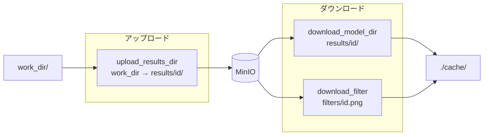


---

## `workers/celery_tasks.py` — 結果の API 送信

`run_experiment` が返す `metrics` 辞書を `UpdateResultsRequest` にマッピングする。

### トップレベル vs `other_metrics`

| 区分            | キー（`metrics` 側）                                                                 | `UpdateResultsRequest` 側 |
| ------------- | ------------------------------------------------------------------------------- | ------------------------ |
| トップレベル        | `global_auc`, `tpr_at_01_fpr`, `tpr_at_1_fpr`, `threshold_at_01_fpr`, `threshold_at_1_fpr`, `total_time_sec` | 同名（`total_time_sec` → `total_time`） |
| `other_metrics` | 上記以外かつ値が `None` でないキー                                                          | `other_metrics` 辞書        |

`build_other_metrics(metrics)` が残りのキーを自動収集する。例:

- LiRA / Shokri: `tpr_at_001_fpr`, `threshold_at_001_fpr`, `shadow_train_accs` 等
- LF_MIA 系: `tpr_at_001_fpr`, `threshold_at_001_fpr`, `attack_score` / `attack_fraction` / `attack_scores_vars`（各 24 要素リスト）, `target_*`, `shadow_*`, `membership_scorer`, `membership_score_scale`, スコアラーの diagnostics（上記 LF_MIA 参照）, `all_scores_*`, `shadow_pair_global_permutation_pvalue`, `shadow_pair_num_significant_fdr` 等
- LF_Mult_MIA / LF_Mult_Diff_MIA: 上記に加え `attack_num_images`

画像ごとのスコア（24 × K）は値が多いため metrics には載せず、`attack_score_distribution/scores.json` にのみ出力する。

`_json_safe_metric_value` で numpy スカラー・配列を JSON 直列化可能な型に変換してから送る。トップレベル取得には `metrics.get(...)` を使用し、一部キーが欠けていても KeyError にならない。

`run_experiment` 中に例外が発生した場合は `status=FAILED`・`error_message=str(e)` で反映する。claim / reflect が 409 を返した場合はスキップ（冪等）、404 はログのみで終了する。

---

## `server_client/`

OpenAPI 生成の httpx クライアント。ワーカーで主に使用:

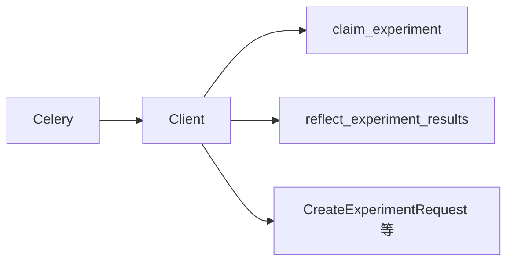


---

## 環境変数


| 変数                                                        | 用途           |
| --------------------------------------------------------- | ------------ |
| `PC_NAME`                                                 | ワーカー識別名      |
| `REDIS_URL`                                               | Celery ブローカー |
| `MINIO_URL` / `MINIO_ACCESS_KEY` / `MINIO_SECRET_KEY` / `MINIO_BUCKET_NAME` | オブジェクトストレージ  |
| `MIAOS_API_URL`                                           | オーケストレータ API |


`core/config.py` 参照。いずれも未設定時は import 時に `KeyError`。`DEVICE` は CUDA 利用可能なら GPU。Celery の `visibility_timeout` は `CELERY_VISIBILITY_TIMEOUT`（16 時間）。

LF_MIA 系で参照する主な定数（抜粋）:

| 定数 | 値 | 用途 |
| ---- | -- | ---- |
| `ATTACK_MODEL_ANALYSIS_DIR` | `analyze_attack_model` | 攻撃モデル解析 PNG / `summary.json` の出力先 |
| `TARGET_ATTACKSIGN_OUTPUT_DIR` | `target_attacksign_output` | ターゲット透かし確率棒グラフ / `summary.json` とターゲットのプローブ特徴バイオリン図の出力先 |
| `SHADOW_PAIR_EFFECT_DIR` | `shadow_pair_effect` | シャドー IN/OUT ペア効果量解析 PNG / `summary.json` とクラス別バイオリン図 `*_violin.png` の出力先 |
| `ATTACK_SCORE_DISTRIBUTION_DIR` | `attack_score_distribution` | ターゲットごとの画像ごとのスコア分布 PNG / `scores.json` の出力先 |
| `NEURAL_REGULARIZED_CV_DIR` | `neural_regularized_cv` | `neural_regularized` の CV・探索結果の出力先 |
| `LIGHTGBM_CV_DIR` | `lightgbm_cv` | `lightgbm` の CV・探索結果の出力先 |
| `SVM_CV_DIR` | `svm_cv` | `svm` の CV・探索結果の出力先 |
| `FLAT_SVM_CV_DIR` | `flat_svm_cv` | `flat_svm` の CV・探索結果の出力先 |
| `SVM_DECISION_ANALYSIS_DIR` | `svm_decision_analysis` | `svm` / `flat_svm` の学習済みモデルの可視化の出力先 |
| `ATTACK_MODEL_BATCH_SIZE` | `64` | `neural` / `neural_regularized` スコアラーのバッチサイズ既定値 |
| `ATTACK_MODEL_EPOCHS` | `100` | `neural` スコアラーのエポック数既定値（Shokri は常にこの値） |
| `SHADOW_PAIR_N_PERMUTATIONS` | `9999` | グローバル置換検定の反復回数 |
| `ATTACK_MODEL_INIT_NAME` | `attack_model_init.pth` | 攻撃モデル初期重み（差分解析のベースライン） |
| `NUM_CLASSES` | `100` | CIFAR-100 クラス数（`AttackNet` 入力次元） |

---

## import 規約

`from src.core.pipeline import run_experiment` のように `src.` プレフィックス付き。  
実行時はプロジェクトルート（または `PYTHONPATH` に worker）を含む構成を前提とする。

## 関連ファイル（`data/` / `attacks/` 抜粋）

```
data/
├── dataset.py
└── decorations/
    ├── protocol.py
    ├── apply_policy.py
    ├── fractional.py
    ├── config.py
    ├── builder.py
    ├── subset.py
    ├── preview.py
    ├── watermark/
    │   ├── filter.py
    │   ├── transform.py
    │   ├── loader.py
    │   ├── decorator.py
    │   ├── watermark_on_black.py
    │   └── composite.py
    └── display_mask/
        └── decorator.py

attacks/
├── mia_attack.py
├── mia_lira_common.py
├── mia_offline_lira.py
├── mia_online_lira.py
├── mia_shokri.py
├── lf_mia.py
├── lf_mult_mia.py
├── lf_mult_diff_mia.py
├── shadow_fraction_sweep.py
├── analysis/
│   ├── attack_model_analysis.py
│   ├── attack_score_distribution.py
│   ├── target_attack_sign_output.py
│   ├── shadow_pair_effect_analysis.py
│   ├── probe_violin.py
│   └── svm_decision_analysis.py
└── membership_scorers/
    ├── __init__.py
    ├── base.py
    ├── neural.py
    ├── pair_cv.py
    ├── neural_regularized.py
    ├── lightgbm_scorer.py
    ├── svm_common.py
    ├── svm_scorer.py
    ├── flat_svm_scorer.py
    ├── diagonal_lda.py
    ├── flat_diagonal_lda.py
    └── gaussian_lr.py
```

